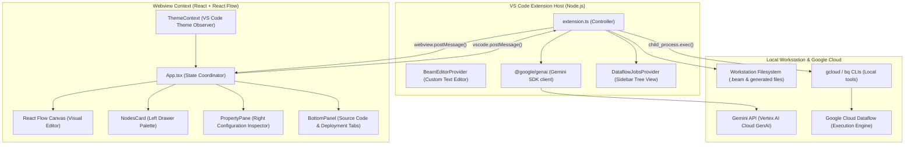
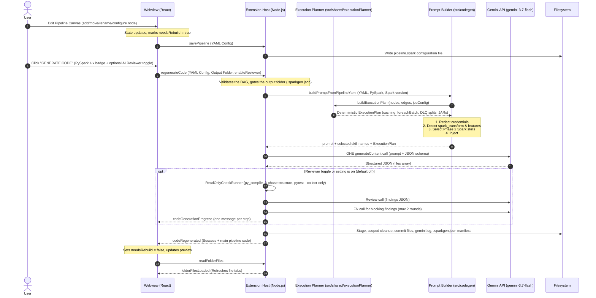

# Architecture Guide: DataFlow Pipeline Builder

> **Author**: Mike Nimer <mikenimer@google.com>  
> **Version**: 1.0.0  
> **Purpose**: This document outlines the software architecture, runtime boundaries, inter-process communication (IPC) protocols, state synchronization models, and Gemini AI integration for the **DataFlow Pipeline Builder** VS Code extension.

---

## High-Level Overview

The DataFlow Pipeline Builder is an interactive visual IDE extension for authoring, configuring, validating, and deploying Apache Beam pipelines on Google Cloud Dataflow. It executes across two isolated runtime contexts connected via an asynchronous IPC bridge:

1. **VS Code Extension Host (Backend)**: Runs in Node.js on the local workstation. It manages the filesystem, handles workspace commands, executes local GCP CLI operations (`gcloud`, `bq`), and communicates with Vertex AI via the `@google/genai` SDK.
2. **Webview Canvas (Frontend)**: Runs inside a sandboxed browser context. Built with React, React Flow, and Tailwind CSS, it renders the interactive DAG graph, palette drawers, property inspectors, and code preview tabs.



---

## 1. Extension Host (`src/extension.ts`)

The Extension Host serves as the controller and native operating system interface for the extension.

### Core Responsibilities
- **Activation Lifecycle**: Registers commands (`refreshPipelines`, `showEditor`, `runPipeline`), custom editor providers, and tree view providers upon activation.
- **`BeamEditorProvider`**: Implements `vscode.CustomTextEditorProvider` to register as the primary visual editor for `*.beam` files. It manages the HTML webview lifecycle, loads React bundle assets (`main.js`, `index.css`), and handles document save/sync lifecycles.
- **IPC Command Dispatcher (`handleMessages`)**: Processes incoming JSON messages from the React webview and returns structured payloads.
- **GCP Environment Discovery**: Executes local CLI commands under the hood (`bq ls --format=json`, `gcloud compute networks subnets list --format=json`) to populate dropdown options in property forms with live project assets.
- **Gemini Client Manager**: Initializes the `@google/genai` client using the active project retrieved dynamically from `gcloud config get project`, pointing the client to Vertex AI (`location: 'global'`).
- **Sidebar Jobs Provider (`DataflowJobsProvider`)**: A dedicated native VS Code Tree View in the activity bar that lists active and historical Dataflow pipeline jobs.

### IPC Message Protocol Registry

| Direction | Command | Payload | Description |
| :--- | :--- | :--- | :--- |
| **Webview &rarr; Ext** | `savePipeline` | `{ yamlContent }` | Persists visual DAG state to the open `*.beam` YAML file. |
| **Webview &rarr; Ext** | `regenerateCode` | `{ yamlContent, language, outputFolder }` | Invokes Gemini to generate complete source code and dependencies. |
| **Webview &rarr; Ext** | `readFolderFiles` | `{ folderPath }` | Queries directory contents to populate generated file tabs. |
| **Webview &rarr; Ext** | `readFileContent` | `{ filePath }` | Loads file text for the syntax-highlighted code editor preview. |
| **Webview &rarr; Ext** | `pickFolder` | `—` | Opens native VS Code folder selection dialog. |
| **Webview &rarr; Ext** | `runPipeline` | `{ jobConfig, language, outputFolder }` | Executes local run script or submits Dataflow job. |
| **Webview &rarr; Ext** | `fetchSubnetworks` | `—` | Queries GCP subnets via `gcloud` CLI. |
| **Ext &rarr; Webview** | `pipelineLoaded` | `{ yamlContent }` | Sends initial `.beam` file content on editor launch. |
| **Ext &rarr; Webview** | `codeRegenerated` | `{ files, mainCode, success }` | Returns generated code and updates code preview. |
| **Ext &rarr; Webview** | `codeGenerationProgress` | `{ message }` | Progress text of a long generation run (optional reviewer steps). |
| **Ext &rarr; Webview** | `folderFilesLoaded`| `{ files }` | Returns updated directory file list. |
| **Ext &rarr; Webview** | `subnetworksLoaded`| `{ subnetworks }` | Returns available GCP subnets for deployment configuration. |

---

## 2. Webview Frontend (`webview/src/`)

The frontend is a single-page application built with React 19, TypeScript, React Flow, and Tailwind CSS, bundled with Vite.

### Component Architecture & Hierarchy

```
App.tsx (Root State Coordinator & Drag Context)
 ├── ThemeProvider (Auto-synchronizes VS Code theme classes)
 ├── ReactFlowProvider
 │    ├── ReactFlow Canvas (Infinite Grid, Background, Edges)
 │    │    ├── PipelineNode (Custom Node Component with Inline Renaming)
 │    │    ├── Controls (Zoom, Fit-view, Auto-layout, Minimap toggle)
 │    │    └── MiniMap (Theme-adaptive category colored nodes)
 │    ├── NodesCard (Left Slide-out Palette)
 │    │    ├── VerticalTabStrip (Sources, Steps, Sinks, Samples)
 │    │    ├── SearchInput (Live filtering)
 │    │    └── SidebarItem (Draggable & Click-to-add items)
 │    ├── PropertyPane (Right Slide-out Inspector)
 │    │    ├── NodeHeader (Editable label, ID, category tag)
 │    │    ├── PropertyForm (Dynamic transform property sheet dispatcher)
 │    │    │    ├── properties/source/*, properties/sink/*, properties/step/* (Per-transform panels)
 │    │    │    └── components/common/* (PropertyField, SecretManagerAuthFields,
 │    │    │         StepExecutionSettingsField, StreamingSinkSettingsField)
 │    │    ├── InfoTooltip (Portal-based documentation popup)
 │    │    └── RuntimeVariables (Copyable dynamic variable drawer)
 │    ├── CanvasToolbar (Undo, Redo, Auto-layout, and Pipeline Mode BATCH/STREAMING pill)
 │    └── BottomPanel (Resizable Drawer Container)
 │         ├── SourceCodeTab (Language picker, Output folder, Code preview)
 │         └── DeploymentTab (Runner config, Streaming defaults, Instance bounds, RUN NOW)
```

### Phase 1 Spark DAG Semantics, Validation & Deterministic Execution Planner

The extension host and React webview share a pure TypeScript graph engine under `src/shared/` and `src/spark/`:

- **Node Capability Registry (`src/shared/sparkNodeCapabilities.ts`)**: Declares read modes, streaming sink modes, DLQ capability, and input arity across all Spark transforms.
- **Direct Source-to-Sink Edges (`usePipelineGraph.ts`, `dagValidator.ts`)**: Allows direct `SOURCE -> SINK` edges for zero-transform replication jobs while rejecting self-loops and invalid directions.
- **Streaming Propagation (`src/shared/sparkDagRules.ts`)**: `computeStreamingNodeSet` marks downstream nodes as streaming while keeping static batch lookup branches for **Stream–Static Joins**.
- **Spark Topology Validation (`src/shared/dagValidator.ts`)**: Enforces acyclic graphs, `Join` handle occupancy, stream–static join rules, stream–stream outer join watermarks, arity, and checkpoint validation.
- **Deterministic Execution Planner (`src/shared/executionPlanner.ts`)**: `buildExecutionPlan` computes topological order, batch fan-out `.cache()` and `.unpersist()` points, DLQ splits, and `foreachBatch` sink groups.
- **Spark 4.x Runtime Matrix (`src/spark/versionMatrix.ts`)**: Maps Serverless 4.0, Serverless 3.0, Cluster 3.0, and Local runtimes (`standard` tier default) to JARs, Maven coordinates, and Python `DataSource` fallbacks.

---

## 3. State Synchronization & Code Generation

Pipeline configurations are persisted as human-readable YAML inside `*.spark` files.



### Prompt Assembly from Skills, Deterministic ExecutionPlan & Response Schema
Code generation makes ONE model call. The prompt is assembled from modular topic skills and the deterministic `ExecutionPlan`. No prompt text lives in TypeScript.

- **Skills** (`resources/codegen-skills/<name>/SKILL.md` plus runner `templates/python/<file>` and `resources/templates/pyspark/<file>`):
  - **Global contract & gate**: `codegen-common` (`kind: common`, always first; enforces the 8 repository deliverables and the testable 3-phase separation `read_sources(spark, config)`, pure `transform(dfs, config)`, and `write_sinks(dfs, config)` tested offline in `tests/test_pipeline.py`) and `verification-gate` (`kind: gate`, always last).
  - **Core PySpark 4.x & Catalyst skills**: `core-pyspark` (`kind: language`, session initialization via `SparkSession.builder` vs. `ManagedSparkSession`, production `logging`, zero-dependency Secret Manager helper, and DLQ `_corrupt_record` / `_error` splits) and `core-catalyst-optimization` (`kind: crosscutting`, `F.broadcast()` lookup joins, no unbounded driver collection, single-pass `.withColumns({...})`, flat `functools.reduce(DataFrame.unionByName, dfs)`, vectorized Arrow `@pandas_udf` / `mapInPandas`, `.coalesce()` vs. `.repartition()`, zero `spark._jsc` / `spark.sparkContext` calls, and deterministic fan-out `.cache()` / `.unpersist()`).
  - **Feature-gated & transform-matched Spark skills**: `core-streaming` (`preloadWhen: [streaming]`, `transforms: [Watermark, StatefulTransform]`; `spark.readStream`, `.withWatermark()`, `availableNow` / `processingTime` / `continuous` triggers, checkpoints, multi-sink `foreachBatch` with `batch_df.cache()` / `unpersist()` and `txnVersion`, and Spark 4.0 `transformWithState`) and `core-python-datasource` (`preloadWhen: [python_datasource]`, `transforms: [PubSubSource, PubSubSink, KinesisSource, KinesisSink, MqttSource, MqttSink, FirestoreSource, FirestoreSink, CassandraSource, RedisSource, RedisSink]`; Spark 4.0 `pyspark.sql.datasource.DataSource` reader/writer/stream templates).
  - **Runner skills & templates**: `runner-local` (`run_local.sh` with `--test` `pytest` mode, `spark-submit`, and optional `ManagedSparkSession` Spark Connect), `runner-dataproc-cluster` (`run_dataproc_cluster.sh` with `gcloud dataproc jobs submit pyspark`), and `runner-serverless-spark` (`run_serverless_spark.sh` with `gcloud dataproc batches submit pyspark`, `--version=4.0`, normalized root `--deps-bucket=gs://<bucket>`, `standard` tier default, and non-root `USER 1099:1099` `Dockerfile`).
- **Pipeline** (`src/codegen/`):
  1. `credentialRedaction.redactPipelineDocument()` strips credentials first so `gemini.log` never records plaintext secrets.
  2. `PipelineFeatureDetector` reads the parsed `.spark` YAML: `spark_transform` / `sparkTransform` set, supported runners (`local`, `dataproc-cluster`, `serverless-spark`), and features (`streaming`, `python_datasource`, `multi_output`, `custom_instructions`).
  3. `CodegenSkillCatalog.select()` filters by caller, language (`python`), runner, kind, transforms, and `preloadWhen` features in deterministic `(kind, name)` order.
  4. `CodegenPromptBuilder.build()` calls `buildExecutionPlan()` from `src/shared/executionPlanner.ts` and emits `codegen-common`, `## Pipeline YAML` (verbatim), `## Execution Plan` (markdown summary + serialized JSON covering topological node order, `isStreaming`, `cacheNodes`, `streamingSinkGroups`, `dlqRoutes`, and `runtimeJars` / `runtimePackages` / `sparkProperties` from `versionMatrix.ts`), the redaction notice (when applicable), and each `## Skill: <name>`, resolving `{{spark_version}}` in skill text and templates only.
- **Shared entry point**: `buildPromptFromPipelineYaml()`. Both the extension (`codeGeneration.ts`) and integration runner (`codegen-runner.ts`) call it.
- **Optional AI Code Reviewer Pass**: Controlled by the `AI Code Reviewer Pass` toggle in `GeneratorSettings.tsx` (`SourceCodeTab.tsx`) or setting `sparkDesigner.codegen.enableReviewer` (default `false`). `ReadOnlyCheckRunner` runs `python3 -m py_compile` on all generated `.py` files, verifies `src/pipeline.py` defines `read_sources`, `transform`, and `write_sinks`, and runs `python3 -m pytest --collect-only -q` when `pytest` is installed. `CodeReviewer` then runs up to two review/fix rounds using `resources/codegen-prompts/{reviewer,fix}.md`.
- **Response JSON Schema**: `resources/code-gen-schema.json`
  - Enforces structured JSON output with an array of files containing `filename`, `content`, and `executable` boolean flags.

---

## 4. Multi-Agent Evaluation Harness (Integration Testing)

To validate that LLM-generated Apache Beam repositories comply with Beam DAG semantics, security hardening, build deployability, and specification fidelity without human intervention, integration tests execute a multi-agent evaluation hierarchy:

1. **Deterministic Pre-Flight Gate (`src/test/integration/evaluators/deterministic-gate.ts`):** Fast non-LLM checks running `py_compile` / Java brace matching and regex scanning for plaintext secrets/credentials.
2. **Specialist Sub-Agents (concurrent via `Promise.all`):**
   - **`BeamArchitectureAgent` (`src/test/integration/evaluators/beam-architecture-evaluator.ts`):** Enforces distributed streaming semantics, windowing on unbounded data, DoFn output tagging integrity (preventing silent element drops), and DLQ error routing.
   - **`PipelineSpecificationAgent` (`src/test/integration/evaluators/pipeline-spec-evaluator.ts`):** Parses the input pipeline YAML and audits the generated code to verify 100% property completeness (e.g. table names, connection URLs, Kafka topics, serializers, flags), custom `system_instructions`, `runtimeVariables`, and `jobConfig`.
   - **`SecurityAndHardeningAgent` (`src/test/integration/evaluators/security-evaluator.ts`):** Audits Secret Manager credentials, container hardening (non-root execution), and shell quoting.
   - **`PackagingAndDeployabilityAgent` (`src/test/integration/evaluators/packaging-evaluator.ts`):** Verifies dependency constraints (e.g. Datafaker >= 2.7.0), build descriptors (`pom.xml`, `requirements.txt`), and runner scripts.
3. **Lead Arbiter & Synthesizer Agent (`src/test/integration/evaluators/arbiter-evaluator.ts`):** Computes multi-dimensional rubric scorecards (Architecture, Specification, Security, Packaging, Maintainability), enforces hard vetoes on critical defects, and emits actionable **Prompt Remediation Directives** that each target one skill file (`targetSkill`, for example `resources/codegen-skills/io-kafka/python.md`) rather than patching generated code.

---

## 5. UI/UX Design System Cross-Reference

For UI design tokens, 8pt spacing grid specifications, typography hierarchies, category color codes, and component styling rules, see `DESIGN.md`.
