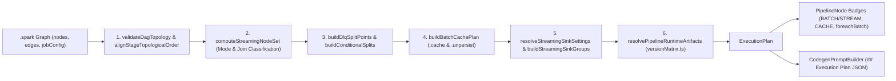
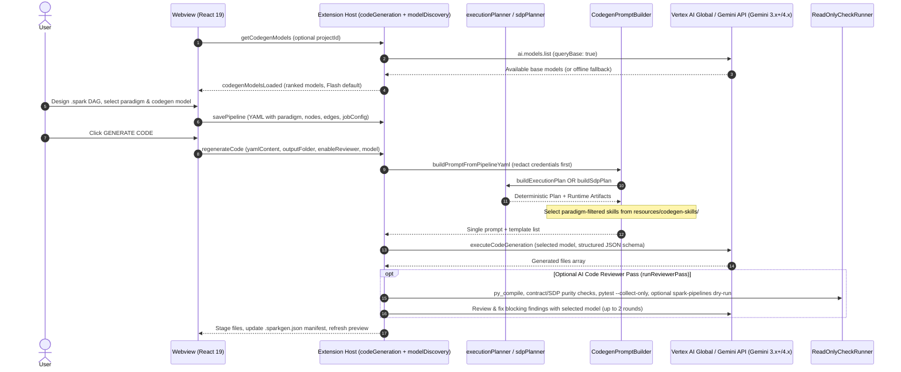

# Architecture Guide: Apache Spark / Managed Spark Pipeline Builder

> Author: Mike Nimer <mikenimer@google.com>  
> Version: 2.0.0  
> Purpose: Documents component topology, dual-paradigm planners, runtime classpath resolution, typed IPC contracts, Gemini code generation, and evaluation gates.

---

## High-Level Overview

The Apache Spark / Managed Spark Pipeline Builder is a VS Code extension for designing, validating, generating, and running Apache Spark 4.x pipelines. One `.spark` custom editor supports three generated output paradigms:

- **Imperative PySpark (`paradigm: imperative`, default)**: Generates `src/pipeline.py`, `tests/test_pipeline.py`, `Dockerfile`, and runner scripts for Local PySpark, Dataproc Clusters, and GCP Serverless Spark.
- **Spark Declarative Pipelines (`paradigm: sdp`, Spark 4.2+)**: Generates `spark-pipeline.yml`, `transformations/*.py` (`from pyspark import pipelines as dp`), pure `src/transforms.py` helpers, `tests/test_transforms.py`, and SDP runners.
- **Jupyter Notebook (`paradigm: notebook`, `.ipynb`)**: Generates `pipeline.ipynb` (nbformat 4.5 for Vertex AI Workbench, Colab Enterprise, and local JupyterLab), pure `src/transforms.py` helpers, `tests/test_transforms.py`, and `run_notebook.sh`.

---

## 1. Spark 4.x Component Topology

The extension runs across two isolated runtime contexts connected through a typed asynchronous IPC bridge, sharing pure cross-boundary TypeScript modules.

```mermaid
flowchart TD
    subgraph Host["VS Code Extension Host (src/ - Node.js)"]
        Ext["extension.ts & core/ (Activation & Constants)"]
        Ed["editor/ (SparkEditorProvider & EditorSession)"]
        Ipc["ipc/ (messageRouter & Domain Handlers)"]
        Cli["cli/ (cliResolver, gcloudClient, resourceMappers)"]
        Codegen["codeGeneration.ts & codegen/ (Prompt, Discovery, Checks)"]
        Gen["generation/ & generationManifest.ts (.sparkgen.json)"]
        Exec["execution/ (PipelineRunner & jobIdDetector)"]
        Sec["security/ (envSanitizer, pathGuard, scriptGuard, uriGuard)"]
        Samples["samples/ & tree/ (samplePipelineService & SparkTreeProvider)"]
    end

    subgraph Shared["Cross-Boundary Pure Engine (src/shared/ & src/spark/)"]
        Proto["protocol.ts & requestParams.ts (Typed IPC & Correlation)"]
        Caps["sparkNodeCapabilities.ts & sparkDagRules.ts"]
        Val["dagValidator.ts (Topology, Arity, Watermarks)"]
        ImpPlan["executionPlanner.ts (Imperative ExecutionPlan)"]
        SdpPlan["sdpPlanner.ts (SDP Compatibility & SdpExecutionPlan)"]
        VM["versionMatrix.ts (Spark 4.x Runtimes & Classpath)"]
    end

    subgraph Web["Webview Frontend (webview/src/ - React 19 + React Flow)"]
        App["App.tsx & pipelineConfigReducer.ts"]
        Toolbar["CanvasToolbar (Mode & Paradigm Controls)"]
        Node["PipelineNode (Badges & Dynamic Handles)"]
        Palette["NodesCard & catalog/ (Sources, Steps, Sinks, Samples)"]
        Props["PropertyPane, PropertyForm, & propertyFormRegistry"]
        Bottom["BottomPanel (SourceCodeTab & DeploymentTab)"]
        Hooks["useVsCodeBridge & useAssetLoader"]
    end

    subgraph Cloud["Workstation & Google Cloud"]
        Disk["Workspace (.spark YAML & Generated Project)"]
        Tools["gcloud / bq / aws / spark-pipelines CLIs"]
        Gemini["Vertex AI Global / Gemini API (gemini-4-hydrogen Default)"]
        Managed["Serverless Spark 4.0 / Dataproc 4.0"]
    end

    Ext --> Ed
    Ext --> Samples
    Ed --> Ipc
    Ipc --> Cli
    Ipc --> Codegen
    Ipc --> Exec
    Codegen --> Gen
    Codegen --> Sec
    Exec --> Sec

    Codegen --> ImpPlan
    Codegen --> SdpPlan
    Codegen --> VM
    Ipc --> Proto

    App --> Toolbar
    App --> Node
    App --> Palette
    App --> Props
    App --> Bottom
    App --> Hooks
    App --> Val
    App --> ImpPlan
    App --> SdpPlan
    Hooks --> Proto

    Hooks -- "vscode.postMessage()" --> Ipc
    Ipc -- "webview.postMessage()" --> Hooks

    Ed --> Disk
    Gen --> Disk
    Cli --> Tools
    Exec --> Tools
    Codegen --> Gemini
    Tools --> Managed
```

### 1.1 VS Code Extension Host (`src/`)

The Extension Host executes in Node.js (CommonJS) and owns filesystem access, process execution, security gates, and SDK calls.

| Subsystem | Key Modules | Architectural Responsibility |
| :--- | :--- | :--- |
| **Activation & Core** | `src/extension.ts`, `src/core/constants.ts`, `src/core/outputChannel.ts` | Registers `spark-pipeline-builder.*` commands, `SPARK_EDITOR_VIEW_TYPE`, `PIPELINE_FILE_EXT` (`.spark`), and the shared output channel. |
| **Custom Editor** | `src/editor/SparkEditorProvider.ts`, `EditorSession.ts`, `documentSync.ts`, `pipelineFileWriter.ts`, `outputFolder.ts`, `pipelineLocation.ts`, `sparkSaveDialog.ts`, `restoredTabUpgrade.ts` | Synchronizes `.spark` YAML documents without edit loops, isolates per-tab child processes, and upgrades plain-text `.spark` tabs. |
| **IPC Dispatch** | `src/ipc/messageRouter.ts`, `messageContext.ts`, `handlers/discoveryHandlers.ts`, `handlers/workspaceHandlers.ts`, `handlers/executionHandlers.ts` | Routes typed webview commands, attaches `requestParams` correlation metadata, and enforces workspace trust before codegen or execution. |
| **Cloud CLI Layer** | `src/cli/cliResolver.ts`, `gcloudClient.ts`, `resourceMappers.ts` | Resolves `gcloud`, `bq`, and `aws` binaries, spawns argument-array `execFile` queries via `listAssets`, and normalizes JSON payloads. |
| **Codegen Engine** | `src/codeGeneration.ts`, `src/credentialRedaction.ts`, `src/codegen/modelDiscovery.ts`, `PipelineFeatureDetector.ts`, `CodegenSkillCatalog.ts`, `skillFile.ts`, `CodegenPromptBuilder.ts`, `codegenConfig.ts`, `ReadOnlyCheckRunner.ts`, `CodeReviewer.ts`, `reviewerPass.ts`, `jsonRepair.ts` | Redacts secrets, discovers Gemini 3.x+/4.x models, selects `resources/codegen-skills/` modules, builds one deterministic prompt, and runs optional AI review passes. |
| **Safe File Staging** | `src/generation/outputFolderGate.ts`, `stagedWriter.ts`, `src/generationManifest.ts` | Verifies output folder safety, writes generated artifacts atomically, and records managed files in `.sparkgen.json`. |
| **Pipeline Execution** | `src/execution/PipelineRunner.ts`, `jobIdDetector.ts` | Resolves allowlisted runner scripts, exports Spark environment variables, detects Serverless Batch or Cluster Job IDs, and cancels active runs. |
| **Security Guards** | `src/security/envSanitizer.ts`, `pathGuard.ts`, `scriptGuard.ts`, `uriGuard.ts` | Strips Spark hijack variables (`PYSPARK_PYTHON`, `PYSPARK_DRIVER_PYTHON`, `SPARK_SUBMIT_OPTS`, `SPARK_CONF_DIR`, `SPARK_HOME`, `SPARK_DIST_CLASSPATH`), validates paths, and restricts executable scripts. |
| **Samples & Sidebar** | `src/samples/samplePipelineService.ts`, `src/resources/resourceLoader.ts`, `src/tree/sparkTree.ts` | Loads bundled `.spark` samples and drives the `sparkExplorer` view (`Pipelines`, `Serverless Batches`, and `Dataproc Cluster Jobs`). |

### 1.2 Cross-Boundary Shared Modules (`src/shared/*` & `src/spark/*`)

Shared modules contain zero `vscode`, `fs`, `path`, `child_process`, `os`, `react`, or `node:*` imports (`src/test/unit/shared-purity.test.ts`). Both the Extension Host and the Vite webview bundle compile these modules directly so validation and planning never drift.

| Module | Shared Exports & Responsibility |
| :--- | :--- |
| `src/shared/types.ts` | Declares `PipelineParadigm`, `SupportedLanguage`, `CodegenModelOption`, `SamplePipeline`, `TokenUsage`, `SdpDatasetKind`, and `SdpDatasetBadge`. |
| `src/shared/protocol.ts` | Declares `WEBVIEW_TO_HOST_COMMANDS`, `WebviewToHostCommand`, `AssetResponseCommand`, and the `HostToWebviewMessage` discriminated union. |
| `src/shared/requestParams.ts` | Extracts and matches `requestParams` payloads so multi-panel or rapid asset lookups ignore stale responses. |
| `src/shared/sparkNodeCapabilities.ts` | Defines `SPARK_NODE_CAPABILITIES` (`supportedReadModes`, `defaultReadMode`, `streamingSinkMode`, `errorOutput`, and `inputArity`) for every transform. |
| `src/shared/sparkDagRules.ts` | Computes `computeStreamingNodeSet`, classifies `JoinExecutionMode`, resolves dual-input `left`/`right` nodes, and derives `ConditionalSplit` handles. |
| `src/shared/dagValidator.ts` | Runs Kahn topological sorting, DFS cycle path extraction, orphan checks, Join/multi-input arity rules, watermark checks, and checkpoint validation. |
| `src/shared/executionPlanner.ts` | Computes the deterministic `ExecutionPlan` for imperative PySpark code generation and canvas badges. |
| `src/shared/sdpPlanner.ts` | Evaluates Apache Spark 4.2 SDP compatibility ceilings (`checkNodeSdpCompatibility`) and computes `SdpExecutionPlan` dataset mappings (`buildSdpPlan`). |
| `src/spark/versionMatrix.ts` | Maps `SparkRuntimeTarget` profiles to Spark, Python, Java, and Scala versions plus connector JARs, Maven packages, and Python `DataSource` classes. |

### 1.3 Webview Frontend (`webview/src/`)

The webview renders inside a sandboxed browser frame built with React 19, React Flow, Tailwind CSS, and Vite.

| Component / Hook | Architectural Responsibility |
| :--- | :--- |
| `App.tsx` & `pipelineConfigReducer.ts` | Coordinates graph state (`usePipelineGraph`), undo/redo snapshots (`useUndoRedoHistory`), paradigm transitions, and functional `jobConfig` updates. |
| `CanvasToolbar.tsx` | Displays the pipeline `BATCH`/`STREAM` badge, provides the 3-option output dropdown (`Imperative`, `SDP (4.2+)`, `Notebook (.ipynb)`), triggers DAG auto-layout, and surfaces validation counts. |
| `PipelineNode.tsx` | Renders custom React Flow cards with `BATCH`/`STREAM` pills, `CACHE`/`foreachBatch` or SDP dataset badges, `left`/`right`/`BROADCAST` handles, dynamic `ConditionalSplit` handles, and `error` DLQ handles. |
| `NodesCard.tsx` & `catalog/` | Provides searchable `Sources` (40), `Steps` (33), `Sinks` (38), and `Samples` tabs, greying out incompatible nodes in SDP mode with explanatory tooltips. |
| `PropertyPane.tsx` & `PropertyForm.tsx` | Lazy-loads per-node forms from `propertyFormRegistry.ts` alongside shared `StorageBackendFields`, `StreamingSinkSettingsField`, `SdpSinkSettingsField`, and `SecretManagerAuthFields`. |
| `BottomPanel/` (`SourceCodeTab`, `DeploymentTab`) | Hosts `GeneratorSettings`, model selection, `CodeViewer`, `RunnerSettings`, `AdvancedConfig`, `SdpSettingsPanel`, `SdpRefreshControls`, and `ExecutionTerminal`. |
| `useVsCodeBridge.ts` & `useAssetLoader.ts` | Manages the `ready` handshake, `.spark` serialization, codegen/runner requests, and `ASSET_CONFIGS` discovery hooks with `requestParams` filtering. |

---

## 2. Deterministic Imperative Execution Planner (`src/shared/executionPlanner.ts`)

Before invoking Gemini or rendering imperative canvas badges, `buildExecutionPlan(nodes, edges, jobConfig)` computes a deterministic `ExecutionPlan`. If the graph contains cycles or partial edges during interactive editing, the planner falls back to input order without throwing.

### 2.1 `buildExecutionPlan` Execution Stages

1. Deduplicate node IDs while ignoring dangling edges whose endpoints do not exist.
2. Sort acyclic graphs topologically via `validateDagTopology`.
3. Defer zero-out-degree terminal `SINK` nodes to the end of `sortedNodeIds` via `alignStageTopologicalOrder`.
4. Propagate streaming mode and `JoinExecutionMode` classifications from `readMode: 'streaming'` sources via `computeStreamingNodeSet`.
5. Build `dlqSplitPoints` for wired `sourceHandle: 'error'` edges via `buildDlqSplitPoints`.
6. Map `ConditionalSplit` rule branches and the `else` fallback via `buildConditionalSplits`.
7. Compute batch `.cache()` directives and topological `.unpersist()` points via `buildBatchCachePlan`.
8. Resolve effective sink triggers, output modes, and checkpoints via `resolveStreamingSinkSettings`.
9. Group streaming sinks across stateful subquery boundaries into `native` or `foreachBatch` writers via `buildStreamingSinkGroups`.
10. Aggregate deduplicated connector JARs, Maven packages, PyPI dependencies, and Spark properties via `resolvePipelineRuntimeArtifacts`.

### 2.2 Streaming Propagation & Join Modes (`sparkDagRules.ts`)

`computeStreamingNodeSet` traverses forward from every `SOURCE` whose effective `readMode` equals `'streaming'`. Any reachable step or sink runs in streaming mode (`pipelineMode: 'streaming'`), while batch lookup branches remain static until joined:

- **`batch_batch` (batch join)**: Both `left` and `right` inputs of `Join` are static batch DataFrames.
- **`stream_static`**: One input is streaming and the lookup side is a static batch DataFrame (supporting `F.broadcast()` enrichment).
- **`stream_stream`**: Both `left` and `right` inputs are streaming DataFrames (requiring watermarks and event-time bounds on outer joins).

### 2.3 Batch Fan-Out Caching & Unpersist Scheduling (`CacheDirective`)

For batch non-sink nodes (`isStreaming: false`), `buildBatchCachePlan` prevents duplicate upstream recomputation across branches:

| `CacheReason` | Trigger Condition | `unpersistAfterNodeIds` Behavior |
| :--- | :--- | :--- |
| `batch_fanout` | Batch node has `outDegree > 1` across standard output handles and `cacheOutput` is not suppressed. | Schedules `.unpersist()` after the last transitive downstream consumer in `sortedNodeIds`. |
| `dlq_split` | Batch node has `outDegree > 1` with at least one wired `sourceHandle: 'error'` edge. | Schedules `.unpersist()` after both valid and error downstream branches finish. |
| `manual_override` | Step inspector sets `cacheOutput` to `true` or `'always'` (`false` or `'never'` suppresses auto-cache). | Schedules `.unpersist()` after the final transitive consumer in topological order. |
| `cache_persist_step` | Explicit `CachePersist` step node appears in a batch branch. | Persists with configured `StorageLevel` and unpersists after the last downstream consumer. |

### 2.4 Streaming Sink Grouping (`streamingSinkGroups`)

`buildStreamingSinkGroups` traces upstream from each streaming sink until hitting a stateful boundary (`SOURCE`, `GroupByAgg`, `RollupCube`, `PivotUnpivot`, `Deduplicate`, `StatefulTransform`, or `stream_stream` `Join`). Connected sinks sharing subquery ancestors merge via union-find:

- **Single Native Sink (`mode: 'native'`, `native_stream_<N>`)**: If a subquery feeds one sink with `streamingSinkMode: 'native'`, it emits a direct `df.writeStream` query.
- **Batch-Only or Multi-Sink Fan-Out (`mode: 'foreachBatch'`, `foreach_batch_<N>`)**: If any sink uses `streamingSinkMode: 'foreachBatch'` or `sinkIds.length > 1`, the planner wraps the group in `.writeStream.foreachBatch(write_micro_batch)`. When `sinkIds.length > 1`, `requiresBatchCache: true` instructs generated code to call `batch_df.cache()` before writing and `batch_df.unpersist()` in a `finally` block. Every `foreachBatch` group sets `idempotentTxnOptions: true` and derives deterministic `txnAppId` metadata for `txnVersion=batch_id` writes.

### 2.5 Dead-Letter Queue Splits (`DlqSplitPoint`) & `ConditionalSplitPlan`

When a step with `errorOutput: true` wires its `error` handle, `buildDlqSplitPoints` records `validTargetIds`, `errorTargetIds`, and the deterministic `DlqMechanism`:

| `DlqMechanism` | Assigned Transforms | Generated PySpark Split Strategy |
| :--- | :--- | :--- |
| `_corrupt_record` | `ParsePayload`, `ParseMessage`, `CsvSource`, `JsonSource`, `XmlSource` | Captures malformed records via Spark `PERMISSIVE` mode and `_corrupt_record` column filtering. |
| `negated_predicate` | `Filter` | Routes matching rows to valid targets and `~(condition)` rows to `error` targets. |
| `expectation_violation` | `DataQualityAssert` | Evaluates combined data quality predicates and routes failing rows with violation details to `error` targets. |
| `try_except_error_col` | `EnforceSchemaAndCast`, `PandasUdfTransform`, `CustomTransform`, `SparkSqlQuery`, `StatefulTransform`, `SparkMlAndVertexAi`, `SparkMlInference`, `VertexAiInference`, `TextChunkAndEmbed` | Captures ANSI `F.try_cast` failures or Python/Arrow partition exceptions into an `_error` struct/string column. |

For `ConditionalSplit` steps, `buildConditionalSplits` emits a `ConditionalSplitPlan` listing each ordered rule branch (`handleId`, `label`, `condition`, `targetNodeIds`) followed by the terminal `else` fallback branch (`isFallback: true`).

---

## 3. Runtime Version & Classpath Matrix (`src/spark/versionMatrix.ts`)

`versionMatrix.ts` maps runner selections to canonical Spark 4.x `RuntimeProfile` definitions and resolves connector dependencies per node. Serverless Spark defaults to `DEFAULT_SERVERLESS_TIER = 'standard'` (`resolveServerlessTier` never defaults silently to `'premium'`).

### 3.1 Canonical `SparkRuntimeTarget` Profiles (`RUNTIME_PROFILES`)

| `SparkRuntimeTarget` | `runner` | Runtime Version | Spark | Python | Java | Scala | Default Tier | `sdpSupported` | Flags & Notes |
| :--- | :--- | :--- | :--- | :--- | :--- | :--- | :--- | :--- | :--- |
| `serverless_4.0` | `ServerlessSpark` | `4.0` | `4.2.0` | `3.13` | `25` | `2.13` | `standard` | `true` | Primary Managed Spark & SDP runtime with pre-installed connectors. |
| `serverless_3.0` | `ServerlessSpark` | `3.0` | `4.0.1` | `3.12` | `21` | `2.13` | `standard` | `false` | Imperative Spark 4.0 Serverless profile with pre-installed connectors. |
| `cluster_4.0` | `DataprocCluster` | `4.0` | `4.2.0` | `3.13` | `25` | `2.13` | — | `true` | Requires `--optional-components=ICEBERG` and driver `zstandard>=0.25.0` for SDP. |
| `cluster_3.0` | `DataprocCluster` | `3.0` | `4.1.2` | `3.12` | `21` | `2.13` | — | `false` | Imperative Dataproc Compute Engine image `3.0` profile. |
| `local_4.2_connect` | `Local` | `4.2-connect` | `4.2.0` | `3.13` | `21` | `2.13` | — | `true` | Sets `missingLocalIcebergRuntime: true` (no `iceberg-spark-runtime-4.2_2.13` on Maven Central). |
| `local` | `Local` | `local` | `4.0.1` | `3.13` | `21` | `2.13` | — | `false` | Default local `pyspark==4.0.*` profile matching Scala 2.13 Maven connectors. |

### 3.2 Pre-Installed Managed Spark Artifacts

On Managed Spark profiles (`serverless_4.0`, `serverless_3.0`, `cluster_4.0`, and `cluster_3.0`), five connectors ship on the platform classpath (`MANAGED_SPARK_PREINSTALLED_CONNECTORS`). `versionMatrix.ts` never passes pre-installed connectors to `spark.jars.packages`:

- `spark-bigquery` (`BigQuerySource`, `BigQuerySink`)
- `iceberg-spark-runtime` (`IcebergSource`, `IcebergSink`, paired with `GCSFileIO` on Serverless Spark)
- `gcs-connector` (`gs://` cloud storage paths)
- `hadoop-aws` (`s3a://` cloud storage paths)
- `hadoop-azure` (`abfss://` and `wasbs://` cloud storage paths)

### 3.3 Connector Delivery Mechanisms (`ConnectorDeliveryMechanism`)

`resolveConnectorForRuntime` classifies every node into one of six delivery strategies and aggregates pipeline-wide outputs in `PipelineRuntimeArtifacts`:

| `ConnectorDeliveryMechanism` | Attachment Mechanism | Representative Transforms & Special Properties |
| :--- | :--- | :--- |
| `builtin` | Native Apache Spark 4.x engine | `Parquet*`, `Orc*`, `Csv*`, `Json*`, `Text*`, `Xml*`, `BinaryFileSource`, `RateSource`, `SocketSource`, `CreateDataFrameSource`, `ConsoleSink`, `MemorySink`, `pyspark.ml`, and chunk-only `TextChunkAndEmbed`. |
| `preinstalled` | Platform classpath on Managed Spark | `BigQuery*`, `Iceberg*`, and built-in file formats reading/writing `gs://`, `s3a://`, or `abfss://` on `serverless_*` and `cluster_*` targets. |
| `gcs_jar` | `--jars` / `spark.jars` (`gcsJars`) | `Spanner*` (`gs://spark-lib/spanner/spark-4.0-spanner-1.5.0.jar`), `Bigtable*` (`gs://spark-lib/bigtable/spark-bigtable_2.13-0.1.0.jar`), and `CloudSql*`/`AlloyDb*`/`Jdbc*` driver and Socket Factory JARs. Sets `dataproc.artifacts.remove=conscrypt` for AlloyDB and SQL Server TLS compatibility. |
| `maven_package` | `--packages` / `spark.jars.packages` (`mavenPackages`) | Spark-versioned `spark-sql-kafka-0-10_2.13` (`Kafka*`, `EventHubs*`) and `spark-avro_2.13`, fixed Scala 2.13 bundles (`Delta*`, `Hudi*`, `Pulsar*`, `Snowflake*`, `Redshift*`, `MongoDb*`, `Elasticsearch*`, `Neo4j*`, `ClickHouse*`, `SingleStore*`, `TFRecord*`), plus local BigQuery/Iceberg/cloud-storage JARs. |
| `python_datasource` | Spark 4.0 `pyspark.sql.datasource.DataSource` + `pipPackages` | `PubSubSource` (`google-cloud-pubsub`), `KinesisSource` (`boto3`), `MqttSource` (`paho-mqtt`), `FirestoreSource` (`google-cloud-firestore`), `CassandraSource` (`cassandra-driver`), `RedisSource` (`redis`), `RestApiSource` (`requests`), and `SftpSource` (`paramiko`). |
| `foreach_batch_sdk` | Python SDK inside `foreachBatch` or `mapInPandas` + `pipPackages` | `PubSubSink`, `KinesisSink`, `MqttSink`, `FirestoreSink`, `CassandraSink`, `RedisSink`, `ForeachBatchSink` (`requests`), `VectorStoreSink` (`psycopg[binary]` + `google-cloud-alloydb-connector` with `dataproc.artifacts.remove=conscrypt`, or `google-cloud-aiplatform`), `SparkMlAndVertexAi` (`xgboost` / `google-cloud-aiplatform`), and `TextChunkAndEmbed` (`google-genai`). |

If `jobConfig` sets `useSparkConnect: true` on `local` or `local_4.2_connect`, `resolvePipelineRuntimeArtifacts` appends `google-cloud-spark-connect` to `pipPackages`.

---

## 4. Imperative PySpark vs. Spark Declarative Pipelines Decision Guide

Users select the paradigm per `.spark` file during pipeline creation or from the `CanvasToolbar` switcher. Switching from SDP to Imperative always succeeds immediately. If a user switches from Imperative to SDP, `evaluateSdpCompatibility` checks every node first and lists blocking issues before switching.

| Dimension | Imperative PySpark (`imperative`) | Spark Declarative Pipelines (`sdp`) |
| :--- | :--- | :--- |
| **Spark Runtime Floor** | Apache Spark 4.0+ (`serverless_4.0`, `serverless_3.0`, `cluster_4.0`, `cluster_3.0`, `local`) | Apache Spark 4.2+ over Spark Connect only (`serverless_4.0`, `cluster_4.0`, `local_4.2_connect`) |
| **Generated Code Shape** | `src/pipeline.py` (`read_sources`, `transform`, `write_sinks`) + `tests/test_pipeline.py` | `spark-pipeline.yml` + `transformations/*.py` (`@dp.*`) + `src/transforms.py` + `tests/test_transforms.py` |
| **Execution Model** | Batch run, `availableNow`, `processingTime` micro-batches, or `continuous` triggers | Triggered incremental `AvailableNow` runs only (no continuous mode) |
| **Lakehouse Persistence** | Explicit `df.writeTo(...)` or `df.writeStream` with manual checkpoints | Managed `@dp.table` streaming tables and `@dp.materialized_view` tables |
| **CDC & SCD Merges** | SCD Type 1 and SCD Type 2 via Catalyst staging + Iceberg/Delta `MERGE INTO` | SCD Type 1 only via `dp.create_auto_cdc_flow(..., stored_as_scd_type=1)` |
| **External Sinks** | Native `writeStream` plus `foreachBatch` sinks (Spanner, Cloud SQL, AlloyDB, JDBC, Pub/Sub) | Streaming `dp.create_sink` connectors only (`foreachBatch`-only sinks blocked) |
| **Spark ML & Caching** | Full `pyspark.ml`, XGBoost, Vertex AI batch inference, and manual `.cache()` / `.unpersist()` | Blocked on canvas (SDP manages table materialization automatically) |

### When to Choose Each Paradigm

- If your pipeline builds BigLake Iceberg medallion tables, file streams, materialized views, or SCD Type 1 flows on Spark 4.2+, choose **SDP (`sdp`)**.
- If your pipeline requires SCD Type 2 history tracking, `foreachBatch` database sinks, Spark ML steps, continuous triggers, or Spark 4.0/4.1 runtimes, choose **Imperative PySpark (`imperative`)**.

---

## 5. Spark Declarative Pipelines Architecture, Ceilings & Execution Model

### 5.1 Hard SDP Ceilings (`src/shared/sdpPlanner.ts`)

In SDP mode, `checkNodeSdpCompatibility` and `buildSdpPlan` enforce nine OSS Apache Spark 4.2 (`branch-4.2`) boundaries deterministically:

| # | Diagnostic / Rule | Enforced SDP Boundary |
| :--- | :--- | :--- |
| 1 | `AUTOCDC_SCD2_NOT_SUPPORTED` | `MergeCdcScd` supports `scdType: 'scd1'` via `dp.create_auto_cdc_flow`. Configuring `scdType: 'scd2'` blocks SDP execution. |
| 2 | `SDP_FOREACH_BATCH_SINK_UNSUPPORTED` | Greys out `foreachBatch`-only sinks (`SpannerSink`, `BigtableSink`, `CloudSqlSink`, `AlloyDbSink`, `JdbcSink`, `SnowflakeSink`, `RedshiftSink`, `PubSubSink`, `KinesisSink`, `FirestoreSink`, `RedisSink`, `VectorStoreSink`, `ForeachBatchSink`). |
| 3 | `SDP_SPARK_ML_UNSUPPORTED` / `SDP_CACHE_PERSIST_UNSUPPORTED` | Disables `FeaturePrep`, `SparkMlAndVertexAi`, `SparkMlInference`, `VertexAiInference`, and `CachePersist` in SDP mode. |
| 4 | `SDP_PIVOT_VALUES_REQUIRED` | Requires explicit `pivotValues` on `PivotUnpivot` (`pivot` mode) because SDP dataset functions forbid eager distinct queries during planning. |
| 5 | `SDP_SPARK_42_REQUIRED` | Requires Apache Spark 4.2+ over Spark Connect (`spark.api.mode=connect`) and rejects runtimes below Spark 4.2. |
| 6 | `SDP_STREAMING_WATERMARK_REQUIRED` | Requires an upstream `Watermark` step before streaming `GroupByAgg`, `RollupCube`, `Deduplicate`, or stream-stream `Join` steps unless materialized as batch views. |
| 7 | `SPECIFY_CLUSTER_BY_WITH_PARTITIONED_BY_IS_NOT_ALLOWED` | Forbids configuring both `partition_cols` and `cluster_by` on the same SDP dataset. |
| 8 | `INVALID_RESETTABLE_DEPENDENCY` | If a streaming table sets `pipelines.reset.allowed=false`, every upstream pipeline streaming table feeding it via `readStream` must also disable reset. |
| 9 | Zero Databricks-Only APIs | Bans `dlt`, `@dp.view`, `@dp.expect*`, `dp.apply_changes`, `append_flow(once=...)`, and `format("cloudFiles")`. Compiles `DataQualityAssert` into filter-based clean and `<dataset>_quarantine` datasets using `src/transforms.py`. |

### 5.2 Triggered Execution, Refresh Safety & Materialized View Truncation

- **Triggered `AvailableNow` Runs Only**: Each `spark-pipelines run` processes available streaming data with `Trigger.AvailableNow`, recomputes materialized views, and exits. `spark-pipeline.yml` forbids `continuous` and `trigger` keys (`PIPELINE_SPEC_UNEXPECTED_FIELD`).
- **Overlapping-Run Guard**: External schedulers and `PipelineRunner` block concurrent SDP runs on the same pipeline so shared `storage` checkpoints never corrupt.
- **Materialized View `TRUNCATE TABLE` Behavior**: SDP executes `TRUNCATE TABLE` on materialized views at run start before flows execute. Downstream readers observe empty materialized views mid-run, and a failed run leaves materialized views empty until the next run succeeds.
- **Full-Refresh Confirmation & Duplicate Sink Warning**: Full refreshes clear streaming tables and drop `__spark_autocdc_aux_state_*` tables, rebuilding only from retained source data. Because `pipelines.reset.allowed` cannot protect `dp.create_sink` targets, `--full-refresh-all` resets sink checkpoints and re-sends retained source records as duplicates.

### 5.3 Dataset Mapping (`buildSdpPlan`)

`src/shared/sdpPlanner.ts` maps compatible graph nodes to deterministic SDP constructs and canvas badges:

| SDP Construct | `kind` | Badge | Assigned Nodes |
| :--- | :--- | :--- | :--- |
| `@dp.temporary_view` | `temporary_view` | `VIEW` | Non-persisted batch sources, intermediate row projections, and watermark views feeding stateful steps. |
| `@dp.materialized_view` | `materialized_view` | `MV` | Batch aggregations (`GroupByAgg`, `RollupCube`), joins against dimensions, and batch Lakehouse sinks. |
| `@dp.table` | `streaming_table` | `TABLE` | Streaming sources (including file streams with explicit `.schema(...)`), streaming filters/projections, and single-input streaming Lakehouse sinks. |
| `dp.create_streaming_table` + `@dp.append_flow` | `append_flow` | `TABLE` | `UnionByName` or multi-branch streaming fan-in targeting one streaming table. |
| `dp.create_streaming_table` + `dp.create_auto_cdc_flow` | `auto_cdc` | `CDC` | `MergeCdcScd` (`scd1`, `left` handle only) paired with a `MERGE`-capable `IcebergSink` or `DeltaSink`. |
| `dp.create_sink` + `@dp.append_flow` | `external_sink` | `SINK` | External streaming sinks (`KafkaSink`, `BigQuerySink`, `PulsarSink`, `EventHubsSink`, file sinks, `ConsoleSink`). |

### 5.4 Managed Data Pipelines `sdp` Stage vs. Standalone Dataproc `4.0` vs. Local `4.2`

- **Managed Data Pipelines `sdp` Stage (`sdp_stage.pipeline.yaml`, primary GCP path)**: Targets Serverless Spark `4.0` (Spark `4.2.0`). Places static Spark properties (`spark.sql.extensions`, `spark.jars*`, `spark.driver.*`, `spark.executor.*`) in `sdp.execution_config.properties` and `jar_uris`, never in `spark-pipeline.yml` `configuration` (`CANNOT_MODIFY_STATIC_CONFIG`).
- **BigLake Iceberg Catalog Contract**: Maps a plain identifier `catalog` alias (such as `lake`) to `https://biglake.googleapis.com/iceberg/v1/restcatalog` with warehouse `bl://projects/<project>/catalogs/<catalog_id>` or bucket-root `gs://<bucket>` (without `/warehouse`). Downstream BigQuery and `dbt` queries read `<project>.<catalog_id>.<database>.<table>` while excluding `__spark_autocdc_metadata` and `__spark_autocdc_aux_state_<table>`.
- **Standalone Dataproc `4.0` (`run_sdp_dataproc.sh`)**: Targets Dataproc Compute Engine image `4.0` with `--optional-components=ICEBERG` and driver `zstandard>=0.25.0`. Executes `CREATE NAMESPACE IF NOT EXISTS <catalog>.<database>` and runs `org.apache.spark.deploy.SparkPipelines` in driver local mode without `spark.master=yarn`.
- **Local Spark `4.2` Connect (`run_sdp_local.sh`)**: Executes `spark-pipelines dry-run` and `run` over `--remote "local[*]"`. If a pipeline includes Iceberg nodes on `local_4.2_connect`, `versionMatrix.ts` sets `missingLocalIcebergRuntime: true` because Maven Central lacks `iceberg-spark-runtime-4.2_2.13`.

---

## 6. Typed IPC Message Registry (`src/shared/protocol.ts`)

All communication between `webview/src/` and `src/` uses strongly typed commands defined in `src/shared/protocol.ts`. `MessageContext.postToWebview` enforces the `HostToWebviewMessage` discriminated union at compile time.

### 6.1 Four-Registry Lockstep Contract & CLI Safety

Every cloud or model discovery command stays synchronized across four registries:

1. Declare the request in `WEBVIEW_TO_HOST_COMMANDS` and `AssetResponseCommand` inside `src/shared/protocol.ts`.
2. Register the handler in `MESSAGE_HANDLERS` (`satisfies Record<WebviewToHostCommand, MessageHandler>`) and `ASSET_REQUEST_COMMANDS` inside `src/ipc/messageRouter.ts`.
3. Add the `AssetType` entry and `ASSET_CONFIGS` mapping (`requestCommand`, `responseCommand`, `responseKey`, `requiredParam`) inside `webview/src/hooks/useAssetLoader.ts`.
4. Re-export the handler, fetch alias, and mapper helpers from `src/extension.ts`.

For every command in `ASSET_REQUEST_COMMANDS`, `withRequestParamsEcho` echoes the originating `requestParams` onto the response so `useAssetLoader` ignores stale or cross-panel replies. All `gcloud`, `bq`, and `aws` lookups execute via `listAssets` using `execFile` argument arrays with regex-validated regions and identifiers. Note that `gcloud beta dataproc session-templates list` uses `--location=<REGION>`, whereas `clusters` and `batches` use `--region=<REGION>`.

### 6.2 `WEBVIEW_TO_HOST_COMMANDS` Registry (35 Commands)

#### Editor & Workspace Commands (`workspaceHandlers.ts`)

| Command | Handler | Host Response | Purpose |
| :--- | :--- | :--- | :--- |
| `ready` | `handleReady` | `loadPipeline`, then `projectIdResolved` | Sends `.spark` YAML immediately on mount, then resolves the cached `gcloud` project asynchronously. |
| `getSamples` | `handleGetSamples` | `samplesLoaded` | Loads bundled `.spark` starter pipelines and companion markdown guides. |
| `openSample` | `handleOpenSample` | Opens custom editor | Prompts for a `.spark` save path, writes the sample, and opens `SPARK_EDITOR_VIEW_TYPE`. |
| `savePipeline` | `handleSavePipeline` | Updates `.spark` document | Writes serialized `.spark` YAML and refreshes `SparkTreeProvider`. |
| `pickFolder` | `handlePickFolder` | `folderSelected` | Opens a workspace folder picker for generated output directories. |
| `readFolderFiles` | `handleReadFolderFiles` | `folderFilesRead` | Lists generated project files (excluding ignored cache/venv directories) and `gemini.log` token usage. |
| `readFileContent` | `handleReadFileContent` | `fileContentLoaded` / `fileContentError` | Reads a generated file inside workspace path guards for `SourceCodeTab`. |
| `showOutputChannel` | `handleShowOutputChannel` | Reveals output panel | Focuses the extension output channel in VS Code. |
| `openExternal` | `handleOpenExternal` | Opens browser link | Opens allowlisted `https://` documentation or Cloud Console URLs (`uriGuard.ts`). |

#### Cloud & Model Asset Discovery Commands (`discoveryHandlers.ts`)

| Command | Response (`AssetResponseCommand` / Union) | Payload Key | Underlying CLI or SDK Query |
| :--- | :--- | :--- | :--- |
| `getDatasets` | `datasetsLoaded` | `datasets` | `bq ls --format=json` |
| `getTables` | `tablesLoaded` | `tables` | `bq ls --format=json <dataset>` (`requiredParam: 'dataset'`) |
| `getTopics` | `topicsLoaded` | `topics` | `gcloud pubsub topics list --format=json` |
| `getSubscriptions` | `subscriptionsLoaded` | `subscriptions` | `gcloud pubsub subscriptions list --format=json` |
| `getNetworks` | `networksLoaded` | `networks` | `gcloud compute networks list --format=json` |
| `getSubnetworks` | `subnetworksLoaded` | `subnetworks` | `gcloud compute networks subnets list --format=json` |
| `getStorageBuckets` | `storageBucketsLoaded` | `buckets` | `gcloud storage buckets list --format=json` |
| `getSecrets` | `secretsLoaded` | `secrets` | `gcloud secrets list --format=json` |
| `getHealthcareDatasets` | `healthcareDatasetsLoaded` | `datasets` | `gcloud healthcare datasets list [--location=...] --format=json` |
| `getAwsQueues` | `awsQueuesLoaded` | `queues` | `aws sqs list-queues --output json` |
| `getComputeInstances` | `computeInstancesLoaded` | `instances` | `gcloud compute instances list --format=json` |
| `getBigtableInstances` | `bigtableInstancesLoaded` | `bigtableInstances` | `gcloud bigtable instances list --format=json` |
| `getBigtableTables` | `bigtableTablesLoaded` | `bigtableTables` | `gcloud bigtable instances tables list --instances=<id> --format=json` (`requiredParam: 'instance'`) |
| `getSqlInstances` | `sqlInstancesLoaded` | `sqlInstances` | `gcloud sql instances list --format=json` |
| `getSqlDatabases` | `sqlDatabasesLoaded` | `sqlDatabases` | `gcloud sql databases list --instance=<id> --format=json` (`requiredParam: 'instance'`) |
| `getProjects` | `projectsLoaded` | `projects` | `gcloud projects list --format=json` |
| `getDataprocClusters` | `dataprocClustersLoaded` | `clusters` | `gcloud dataproc clusters list --region=<region> --filter="status.state = RUNNING" --limit=100 --format=json` |
| `getSessionTemplates` | `sessionTemplatesLoaded` | `sessionTemplates` | `gcloud beta dataproc session-templates list --location=<location> --limit=50 --format=json` |
| `getBigLakeCatalogs` | `bigLakeCatalogsLoaded` | `catalogs` | `gcloud biglake iceberg catalogs list --format=json` |
| `getRegions` | `regionsLoaded` | `regions` | `gcloud compute regions list --format=json` |
| `getCodegenModels` | `codegenModelsLoaded` | `models` | `@google/genai` `ai.models.list({ config: { queryBase: true } })` on Vertex AI `global` or Gemini API |
| `getRunningJobs` | `runningJobsLoaded` | `jobs` | Lists active cloud pipeline jobs via `gcloud` for the selected project and region |

#### Code Generation Commands (`executionHandlers.ts`)

| Command | Handler | Host Responses | Purpose |
| :--- | :--- | :--- | :--- |
| `regenerateCode` | `handleRegenerateCodeCommand` | `codeGenerationProgress`, `codeRegenerated` | Redacts secrets, builds the skill prompt, runs Gemini generation and optional review, and stages files. |
| `stopCodeGeneration` | `handleStopCodeGeneration` | `codeGenerationStopped` | Aborts the active per-session `AbortController` during Gemini generation or review. |

#### Pipeline Execution Commands (`executionHandlers.ts`)

| Command | Handler | Host Responses | Purpose |
| :--- | :--- | :--- | :--- |
| `runPipeline` | `handleRunPipeline` | `pipelineStarted`, `pipelineLog`, `pipelineJobIdDetected`, `pipelineFinished` | Validates workspace trust and script allowlists, guards SDP overlap, and spawns the runner script. |
| `stopPipeline` | `handleStopPipeline` | `pipelineStopped` | Terminates the local process group and optionally cancels the remote Serverless batch or Dataproc job. |

### 6.3 `HostToWebviewMessage` Union Summary

In addition to `AssetListResponse` (covering all 21 `AssetResponseCommand` values above), `HostToWebviewMessage` defines 16 lifecycle, codegen, runner, and file messages:

| Message `command` | Interface | Payload Highlights |
| :--- | :--- | :--- |
| `loadPipeline` | `LoadPipelineMessage` | `data` (`.spark` YAML or `null`), `filename`, `relativeFolder`, `defaultOutputFolder` |
| `projectIdResolved` | `ProjectIdResolvedMessage` | `projectId` resolved asynchronously from `gcloud config get-value project` |
| `samplesLoaded` | `SamplesLoadedMessage` | `samples` (`SamplePipeline[]`) |
| `codeRegenerated` | `CodeRegeneratedMessage` | `success`, `code`, `model`, `tokenUsage`, `cancelled`, `error` |
| `codeGenerationStopped` | `CodeGenerationStoppedMessage` | Confirms cancellation of an in-flight Gemini request |
| `codeGenerationProgress` | `CodeGenerationProgressMessage` | `message` describing active generation or AI reviewer progress |
| `pipelineStarted` | `PipelineStartedMessage` | `runner`, `commandLine`, `folderPath` |
| `pipelineLog` | `PipelineLogMessage` | `text` chunk and `stream` (`'stdout'` or `'stderr'`) |
| `pipelineJobIdDetected` | `PipelineJobIdDetectedMessage` | `jobId`, `runner`, `projectId`, `region` parsed by `jobIdDetector.ts` |
| `pipelineFinished` | `PipelineFinishedMessage` | `exitCode` and terminal `status` (`'completed'`, `'failed'`, or `'stopped'`) |
| `pipelineStopped` | `PipelineStoppedMessage` | Confirms user-initiated runner stop |
| `runningJobsLoaded` | `RunningJobsLoadedMessage` | `jobs`, `projectId`, `error`, `debugLog` |
| `folderSelected` | `FolderSelectedMessage` | `path` chosen in the workspace folder dialog |
| `folderFilesRead` | `FolderFilesReadMessage` | `files` relative to `folderPath` plus optional `tokenUsage` |
| `fileContentLoaded` | `FileContentLoadedMessage` | `filePath` and UTF-8 `content` |
| `fileContentError` | `FileContentErrorMessage` | `filePath` and `error` reason |

---

## 7. Skill-Based Code Generation & Dynamic Model Routing

### 7.1 Single-Prompt Skill Assembly (`CodegenPromptBuilder.ts` & `ReadOnlyCheckRunner.ts`)

1. Redact sensitive node properties with `redactPipelineDocument` before building the prompt.
2. Detect pipeline features, runner family, and paradigm (`imperative`, `sdp`, or `notebook`) via `PipelineFeatureDetector`.
3. Inject the deterministic `ExecutionPlan` (`buildExecutionPlan`) or `SdpExecutionPlan` (`buildSdpPlan`) Markdown summary and JSON block.
4. Select matching `resources/codegen-skills/` entries in deterministic `SKILL_KIND_ORDER` (`common`, `language`, `runner`, `io`, `transform`, `crosscutting`, `review`, `gate`).
5. Resolve `{{spark_version}}` inside skill text only, preserving user `.spark` YAML and `{{pipeline_name}}`, `{{pipeline_class_name}}`, and `{{gcs_staging_path}}` verbatim.
6. If settings enable the reviewer pass, execute `ReadOnlyCheckRunner` (`py_compile`, contract checks, `pytest --collect-only`, and optional `spark-pipelines dry-run`).

### 7.2 Dynamic Gemini Model Discovery & Routing (`src/codegen/modelDiscovery.ts`)

1. Dispatch `getCodegenModels` (with an optional validated `projectId`) from the webview through the four-registry discovery pipeline.
2. Run `discoverCodegenModels` via `@google/genai` `ai.models.list({ config: { queryBase: true } })` on Vertex AI (`location: 'global'`) or Gemini API.
3. Filter out deprecated pre-3.x releases, tuned models, embeddings, media models, and live-only endpoints via `filterAndRankCodegenModels`.
4. Rank Gemini 3.x+ and 4.x text models by descending version with Flash-class models (`gemini-4-hydrogen` default) prioritized first.
5. If credentials are missing or listing fails, fall back without throwing to `DEFAULT_GEMINI_MODEL` (`gemini-4-hydrogen`).
6. Forward the selected `model` through `regenerateCode` into both `executeCodeGeneration` and `runReviewerPass`.

---

## 8. Multi-Agent Evaluation Harness & Verification Gate (`src/test/integration/`)

Integration suites validate generated Imperative and SDP repositories offline and with multi-agent rubrics using `gemini-4-hydrogen` on Vertex AI `location: 'global'`:

- **Deterministic Pre-Flight Gate (`deterministic-gate.ts`)**: Runs `py_compile`, `bash -n`, JSON/YAML validation, Imperative D3 or SDP contract checks, banned-API/secret scans, and optional `spark-pipelines dry-run`.
- **`SparkArchitectureAgent` (`spark-architecture-evaluator.ts`)**: Audits `transform(dfs)` separation, Catalyst rules, cache pairing, `foreachBatch` idempotency, watermarks, classpath hygiene, and SDP dataset purity.
- **`PipelineSpecificationAgent` (`pipeline-spec-evaluator.ts`)**: Builds a Requirement Traceability Matrix verifying `ExecutionPlan` or `SdpExecutionPlan` fidelity across nodes, edges, quarantine tables, and Auto CDC flows.
- **`SecurityAndHardeningAgent` (`security-evaluator.ts`)**: Audits Secret Manager credential helpers, non-root `USER 1099:1099` Dockerfiles, and safe shell quoting.
- **`PackagingAndDeployabilityAgent` (`packaging-evaluator.ts`)**: Audits `requirements.txt` (`pyspark==4.0.*` for imperative local or `pyspark` 4.2+ for SDP), runner script flags, namespace creation, and `sdp_stage.pipeline.yaml`.
- **Lead Arbiter (`arbiter-evaluator.ts`)**: Synthesizes specialist scorecards, applies hard vetoes on critical defects, and emits skill-level remediation directives.
- **Offline Pytest Runner (`pytest-runner.ts`)**: Executes generated `pytest` suites offline against local PySpark 4.x test sessions.

For UI tokens, 8pt spacing rules, paradigm badges, and property inspector layouts, see `DESIGN.md`.
