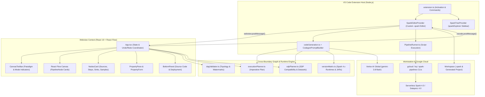
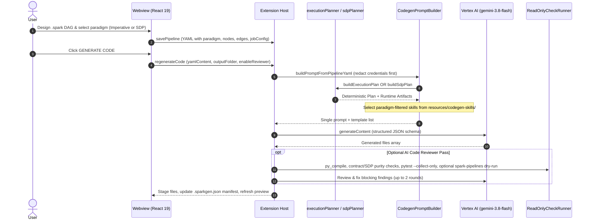

# Architecture Guide: Apache Spark / Managed Spark Pipeline Builder

> **Author**: Mike Nimer <mikenimer@google.com>  
> **Version**: 2.0.0  
> **Purpose**: Documents the runtime boundaries, dual-paradigm planners, IPC contracts, Gemini code generation pipeline, and multi-agent evaluation harness for the Apache Spark / Managed Spark Pipeline Builder VS Code extension.

---

## High-Level Overview

The Apache Spark / Managed Spark Pipeline Builder is a visual VS Code extension for designing, validating, generating, and running Apache Spark 4.x pipelines. It supports two pipeline paradigms from one `.spark` visual editor:

1. **Imperative PySpark (`paradigm: imperative`, default)**: Generates standalone PySpark 4.x DataFrame, Catalyst SQL, and Structured Streaming projects (`src/pipeline.py`, `tests/test_pipeline.py`, `Dockerfile`, and local, Dataproc, and Serverless Spark runners).
2. **Spark Declarative Pipelines (`paradigm: sdp`, Apache Spark 4.2+)**: Generates `spark-pipeline.yml`, Python dataset modules under `transformations/*.py` (`from pyspark import pipelines as dp`), pure helpers in `src/transforms.py`, offline unit tests in `tests/test_transforms.py`, and Managed Data Pipelines `sdp` stage artifacts.

The extension executes across two isolated runtime contexts connected over an asynchronous IPC bridge:

- **VS Code Extension Host (`src/`)**: Runs in Node.js on the workstation. It manages `.spark` custom editors, workspace file safety gates, local Google Cloud CLI discovery (`gcloud`, `bq`), runner execution, and Vertex AI requests (`@google/genai`, `gemini-3.8-flash` on `location: 'global'`).
- **Webview Canvas (`webview/src/`)**: Runs inside a sandboxed browser context. Built with React 19, React Flow, and Tailwind CSS, it renders the DAG canvas, node palette, property inspectors, code preview tabs, and deployment controls.

---

## 1. Imperative PySpark vs. Spark Declarative Pipelines Decision Guide

Users choose the paradigm per `.spark` file when creating a pipeline or from the `CanvasToolbar` paradigm switcher. Switching from SDP to Imperative always succeeds immediately. Switching from Imperative to SDP runs `evaluateSdpCompatibility` and displays every blocking node before permitting the switch.

| Dimension | Imperative PySpark (`imperative`) | Spark Declarative Pipelines (`sdp`) |
| :--- | :--- | :--- |
| **Spark Runtime Floor** | Apache Spark 4.0+ (Serverless 3.0/4.0, Dataproc 3.0/4.0, Local 4.0) | Apache Spark 4.2+ over Spark Connect only (Serverless 4.0, Dataproc 4.0, Local 4.2 Connect) |
| **Generated Code Shape** | `src/pipeline.py` (`read_sources`, `transform`, `write_sinks`) + `tests/test_pipeline.py` | `spark-pipeline.yml` + `transformations/*.py` (`@dp.*`) + `src/transforms.py` + `tests/test_transforms.py` |
| **Execution Model** | Batch run, `availableNow`, `processingTime` micro-batches, or `continuous` triggers | Triggered incremental `AvailableNow` runs only (no continuous mode) |
| **Lakehouse Persistence** | Explicit `df.writeTo(...)` or `df.writeStream` with manual checkpoints | Managed `@dp.table` streaming tables and `@dp.materialized_view` tables |
| **CDC & SCD Merges** | SCD Type 1 and SCD Type 2 via Catalyst staging + Iceberg/Delta `MERGE INTO` | SCD Type 1 only via `dp.create_auto_cdc_flow(..., stored_as_scd_type=1)` |
| **External Sinks** | Native `writeStream` plus `foreachBatch` sinks (Spanner, Cloud SQL, AlloyDB, JDBC, Pub/Sub) | Streaming `dp.create_sink` connectors only (`foreachBatch`-only sinks blocked) |
| **Spark ML & Caching** | Full `pyspark.ml`, XGBoost, Vertex AI batch inference, and manual `.cache()` / `.unpersist()` | Blocked on canvas (SDP manages table materialization automatically) |

### When to Choose Each Paradigm
- If your pipeline builds bronze-silver-gold BigLake Iceberg tables, incremental file streams, batch materialized views, or SCD Type 1 Auto CDC tables on Spark 4.2+, choose **Spark Declarative Pipelines (`sdp`)**.
- If your pipeline requires SCD Type 2 history tracking, `foreachBatch` database sinks (Spanner, Cloud SQL, AlloyDB, Bigtable, JDBC, Pub/Sub), Spark ML steps, continuous streaming triggers, or Spark 4.0/4.1 runtimes, choose **Imperative PySpark (`imperative`)**.

---

## 2. Spark Declarative Pipelines Architecture, Ceilings & Execution Model

### 2.1 Hard SDP Ceilings (`src/shared/sdpPlanner.ts`)
In SDP mode, `checkNodeSdpCompatibility` and `buildSdpPlan` enforce OSS Apache Spark 4.2 (`branch-4.2`) boundaries deterministically:

1. **SCD Type 1 Only (`AUTOCDC_SCD2_NOT_SUPPORTED`)**: `MergeCdcScd` supports `scdType: 'scd1'` through `dp.create_auto_cdc_flow`. Configuring `scdType: 'scd2'` blocks SDP execution.
2. **No `foreachBatch`-Only Sinks (`SDP_FOREACH_BATCH_SINK_UNSUPPORTED`)**: Sinks whose `streamingSinkMode` equals `'foreachBatch'` (such as `SpannerSink`, `BigtableSink`, `CloudSqlSink`, `AlloyDbSink`, `JdbcSink`, `SnowflakeSink`, `RedshiftSink`, `PubSubSink`, `KinesisSink`, `FirestoreSink`, `RedisSink`, `VectorStoreSink`, and `ForeachBatchSink`) are greyed out in the SDP palette.
3. **No Spark ML or Manual Caching (`SDP_SPARK_ML_UNSUPPORTED`, `SDP_CACHE_PERSIST_UNSUPPORTED`)**: `FeaturePrep`, `SparkMlAndVertexAi`, `SparkMlInference`, `VertexAiInference`, and `CachePersist` are disabled in SDP mode.
4. **Explicit Pivot Values Required (`SDP_PIVOT_VALUES_REQUIRED`)**: `PivotUnpivot` in `pivot` mode requires explicit `pivotValues` because SDP dataset functions cannot execute eager distinct queries during graph planning.
5. **Apache Spark 4.2+ Spark Connect Only (`SDP_SPARK_42_REQUIRED`)**: SDP runs exclusively over Spark Connect (`spark.api.mode=connect`) on Spark 4.2 or newer. Runtimes below Spark 4.2 are rejected.
6. **Watermarks Before Stateful Streaming Steps (`SDP_STREAMING_WATERMARK_REQUIRED`)**: Streaming `GroupByAgg`, `RollupCube`, `Deduplicate`, and stream-stream `Join` steps require an upstream `Watermark` step unless explicitly materialized as batch views.
7. **Mutually Exclusive Partitioning & Clustering (`SPECIFY_CLUSTER_BY_WITH_PARTITIONED_BY_IS_NOT_ALLOWED`)**: A dataset cannot set both `partition_cols` and `cluster_by`.
8. **Reset Protection Propagation (`INVALID_RESETTABLE_DEPENDENCY`)**: If a streaming table sets `pipelines.reset.allowed=false`, every upstream pipeline streaming table feeding it via `readStream` must also set `pipelines.reset.allowed=false`.
9. **Zero Databricks-Only APIs**: OSS Spark 4.2 has no `dlt` module, `@dp.view`, `@dp.expect*`, `dp.apply_changes`, `append_flow(once=...)`, or `format("cloudFiles")`. `DataQualityAssert` compiles to filter-based clean and `<dataset>_quarantine` datasets using pure predicates in `src/transforms.py`.

### 2.2 Triggered Execution Model, Refresh Safety & Materialized View Truncation
- **Triggered `AvailableNow` Runs Only**: Each `spark-pipelines run` processes currently available streaming records with `Trigger.AvailableNow`, recomputes materialized views, and exits. `spark-pipeline.yml` forbids `continuous` and `trigger` keys (`PIPELINE_SPEC_UNEXPECTED_FIELD`).
- **No Overlapping Runs**: External schedulers (Managed Data Pipelines, Cloud Composer, or Cloud Scheduler) and the extension's `PipelineRunner` guard against overlapping runs of the same pipeline because concurrent runs corrupt shared checkpoints under `storage`.
- **Materialized View Truncation Behavior**: SDP executes `TRUNCATE TABLE` on materialized views at the start of every run before flows execute. Downstream readers observe empty materialized views mid-run, and a failed run leaves materialized views empty until the next successful run.
- **Full-Refresh Confirmation & Sink Duplicate Warning**: Full refreshes empty streaming tables and drop `__spark_autocdc_aux_state_*` tables, rebuilding only from retained source data. Because `pipelines.reset.allowed` cannot protect external `dp.create_sink` targets, `--full-refresh-all` resets sink checkpoints and re-sends available source records to Kafka or BigQuery as duplicates.

### 2.3 Dataset Mapping (`buildSdpPlan`)
`src/shared/sdpPlanner.ts` maps compatible nodes to deterministic dataset kinds and canvas badges:

|SDP Construct | `kind` | Badge | Assigned Nodes |
| :--- | :--- | :--- | :--- |
| `@dp.temporary_view` | `temporary_view` | `VIEW` | Non-persisted batch sources, intermediate row projections, and watermark views feeding stateful steps |
| `@dp.materialized_view` | `materialized_view` | `MV` | Batch aggregations (`GroupByAgg`, `RollupCube`), joins against dimensions, and batch Lakehouse sinks |
| `@dp.table` | `streaming_table` | `TABLE` | Streaming sources (including file streams with explicit `.schema(...)`), streaming row filters/projections, and single-input streaming Lakehouse sinks |
| `dp.create_streaming_table` + `@dp.append_flow` | `append_flow` | `TABLE` | `UnionByName` or multi-branch streaming fan-in into one target streaming table |
| `dp.create_streaming_table` + `dp.create_auto_cdc_flow` | `auto_cdc` | `CDC` | `MergeCdcScd` (`scd1`, `left` handle only) paired with a `MERGE`-capable `IcebergSink` or `DeltaSink` |
| `dp.create_sink` + `@dp.append_flow` | `external_sink` | `SINK` | External streaming sinks (`KafkaSink`, `BigQuerySink`, `PulsarSink`, `EventHubsSink`, file sinks, `ConsoleSink`) |

### 2.4 Managed Data Pipelines `sdp` Stage vs. Standalone Dataproc `4.0` vs. Local `4.2`
- **Managed Data Pipelines `sdp` Stage (`sdp_stage.pipeline.yaml`, primary GCP path)**: Runs on Managed Spark Serverless `4.0` (Spark `4.2.0`). Static Spark properties (`spark.sql.extensions`, `spark.jars*`, `spark.driver.*`, `spark.executor.*`) live in `sdp.execution_config.properties` and `jar_uris`, never in `spark-pipeline.yml` `configuration` (`CANNOT_MODIFY_STATIC_CONFIG`).
- **BigLake Iceberg Catalog Contract**: `spark-pipeline.yml` uses a plain identifier `catalog` alias (such as `lake`) mapped to `https://biglake.googleapis.com/iceberg/v1/restcatalog` with warehouse `bl://projects/<project>/catalogs/<catalog_id>` (or bucket-root `gs://<bucket>` without `/warehouse`). Downstream BigQuery and `dbt` queries reference `<project>.<catalog_id>.<database>.<table>` and exclude `__spark_autocdc_metadata` and `__spark_autocdc_aux_state_<table>`.
- **Standalone Self-Managed Dataproc `4.0` (`run_sdp_dataproc.sh`)**: Targets Dataproc Compute Engine image `4.0` (`--optional-components=ICEBERG` and driver package `zstandard>=0.25.0`). Runs `CREATE NAMESPACE IF NOT EXISTS <catalog>.<database>` and launches `org.apache.spark.deploy.SparkPipelines` in driver local mode without conflicting `spark.master=yarn` settings.
- **Local Spark `4.2` Spark Connect (`run_sdp_local.sh`)**: Runs `spark-pipelines dry-run` and `run` over `--remote "local[*]"`. Because Maven Central lacks `iceberg-spark-runtime-4.2_2.13`, `versionMatrix.ts` sets `missingLocalIcebergRuntime: true` on `local_4.2_connect` and warns when Iceberg nodes are present.

---

## 3. Imperative Execution Planner & Runtime Matrix

For imperative pipelines (`paradigm: imperative`), `src/shared/executionPlanner.ts` computes an `ExecutionPlan` before calling Gemini:

1. **Streaming Propagation (`sparkDagRules.ts`)**: Marks nodes reachable from streaming sources while preserving static right lookup inputs on stream-static joins.
2. **Batch Fan-Out Caching (`cacheDirectives`)**: Inserts `.cache()` on batch nodes with out-degree greater than one and `.unpersist()` after downstream sinks complete.
3. **Streaming Sink Grouping (`streamingSinkGroups`)**: Emits native `.writeStream` queries for single native sinks and groups `foreachBatch` sinks or multi-sink fan-outs into one micro-batch writer with `batch_df.cache()`, `txnVersion`, `txnAppId`, and `batch_df.unpersist()`.
4. **Runtime Matrix (`src/spark/versionMatrix.ts`)**: Resolves `serverless_4.0` (Spark 4.2.0), `serverless_3.0` (Spark 4.0.1), `cluster_4.0` (Spark 4.2.0), `cluster_3.0` (Spark 4.1.2), `local_4.2_connect` (Spark 4.2.0), and `local` (Spark 4.0.1) along with pre-installed Managed Spark connectors, GCS JARs, Maven packages, and Spark 4.0 Python `DataSource` fallbacks.

---

## 4. State Synchronization & Skill-Based Code Generation

---

## 5. Multi-Agent Evaluation Harness & Verification Gate

Integration tests (`src/test/integration/`) validate generated Imperative and SDP repositories offline and via multi-agent rubrics:

1. **Deterministic Pre-Flight Gate (`deterministic-gate.ts`)**: Compiles Python files (`py_compile`), checks shell syntax (`bash -n`), parses JSON and YAML artifacts, audits Imperative D3 or SDP deliverables, enforces `spark-pipeline.yml` schema and static-config bans, scans for banned Spark/Databricks APIs and plaintext secrets, and runs `spark-pipelines dry-run` when installed.
2. **Specialist Evaluators**:
   - **`SparkArchitectureAgent` (`spark-architecture-evaluator.ts`)**: Audits D3 separation, Catalyst rules, cache discipline, `foreachBatch` idempotency, watermarks, classpath hygiene, and SDP dataset purity, query-type matching, and Databricks API bans.
   - **`PipelineSpecificationAgent` (`pipeline-spec-evaluator.ts`)**: Builds a Requirement Traceability Matrix (RTM) and verifies `ExecutionPlan` or `SdpExecutionPlan` compliance across all node properties, edges, quarantine tables, and Auto CDC flows.
   - **`SecurityAndHardeningAgent` (`security-evaluator.ts`)**: Verifies Secret Manager credential resolution, non-root `USER 1099:1099` containers, and shell quoting.
   - **`PackagingAndDeployabilityAgent` (`packaging-evaluator.ts`)**: Audits `requirements.txt` (`pyspark==4.0.*` for imperative local or `pyspark` 4.2+ for SDP), runner script flags, namespace setup, and `sdp_stage.pipeline.yaml`.
3. **Lead Arbiter (`arbiter-evaluator.ts`) & Offline Pytest Runner (`pytest-runner.ts`)**: Synthesizes specialist findings, applies hard vetoes on critical defects, emits skill-level remediation directives, and executes offline `pytest` suites against local PySpark sessions.

For UI tokens, 8pt spacing rules, paradigm badges, and inspector layouts, see `DESIGN.md`.
