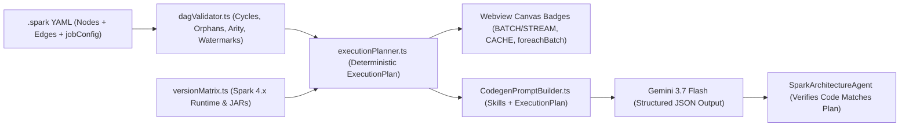

# SPARK-TASKS.md — Apache Spark Pipeline Builder Architecture & Task Plan

> **Author**: Mike Nimer <mikenimer@google.com>  
> **Version**: 2.0.0  
> **Target Extension**: `apache-spark-designer` ("Apache Spark / Managed Spark Pipeline Builder")  
> **Baseline Fork**: `apache-beam-designer` (`develop` @ `b54945d`, including merged skill-based codegen `#108` and `#110`)  
> **Target Engine**: Apache Spark 4.x (PySpark DataFrame, Catalyst SQL, and Structured Streaming APIs)  
> **Execution Platforms**: Local PySpark (`local[*]` + optional Spark Connect), Dataproc Cluster (`gcloud dataproc jobs submit pyspark`), GCP Serverless Spark (`gcloud dataproc batches submit pyspark`)

---

## Task Index

**This table is the single source of truth for task status.** Update only the `Status` cell below. Detail sections carry no checkboxes so status can never drift.

Legend: `⬜ Not Started` · `🟦 In Progress` · `⏸️ Deferred` · `✅ Done` · `❌ Won't Fix`

> [!NOTE]
> **Task Families**:
> - `S0–S11`: Repository Scaffold & Security Hygiene (12 tasks)
> - `A1–A14`: Architecture, Graph Semantics & Deterministic Execution Planner (14 tasks)
> - `G1–G12`: Modular Skill-Based PySpark Codegen Engine & Core Skills (12 tasks)
> - `R1–R12`: Runners, Deployment UI & Sidebar Job Explorer (12 tasks)
> - `D1–D6`: Live GCP Asset Discovery (6 tasks)
> - `SRC1–SRC38`: Source Nodes, Property Forms & Skills (38 tasks)
> - `SNK1–SNK37`: Sink Nodes, Property Forms & Skills (37 tasks)
> - `OP1–OP29`: Step / Transformation Nodes, Property Forms & Skills (29 tasks)
> - `T1–T10`: Unit Tests & Multi-Agent Spark Evaluator Harness (10 tasks)
> - `I1–I10`: Starter Samples & End-to-End Integration Pipelines (10 tasks)
> - `DOC1–DOC6`: Documentation & Walkthroughs (6 tasks)
> - `V2`: Phase-2 Deferred Backlog (5 items)

### Phase 0 — Repository Scaffold & Hygiene (`S0`–`S11`)

| # | Type | Task | Status |
| :--- | :--- | :--- | :--- |
| [S0](#s0) | 🏗️ Scaffold | Merge skill-based codegen (`#108` and `#110`) into `develop` and fast-forward this worktree. | ✅ Done (`b54945d`) |
| [S1](#s1) | 🏗️ Scaffold | Initialize the fresh `apache-spark-designer` Git repo with clean history; copy `KEEP` and `ADAPT` files and omit all `DELETE` files (see Section 3). Preserve `node_modules` for offline/Airlock builds. | ✅ Done |
| [S2](#s2) | 🏗️ Scaffold | Rename extension metadata, commands (`spark-pipeline-builder.*`), custom editor (`spark-pipeline-builder.sparkEditor`), activity bar (`antigravity-spark-designer`), and view (`sparkExplorer`) in `package.json`. | ✅ Done |
| [S3](#s3) | 🏗️ Scaffold | Introduce `PIPELINE_FILE_EXT = '.spark'` in `src/core/constants.ts` and replace every `.beam` literal across host and webview code. | ✅ Done |
| [S4](#s4) | 🏗️ Scaffold | Rename generation ownership manifest from `.beam-generated.json` to `.sparkgen.json` in `src/generationManifest.ts` and update workspace storage keys and credential redaction placeholders. | ✅ Done |
| [S5](#s5) | 🏗️ Scaffold | Rename `beam_transform` to `spark_transform` and `beamTransform` to `sparkTransform` across catalog types, YAML serializer, and `legacyNodeMigration.ts`. | ✅ Done |
| [S6](#s6) | 🏗️ Scaffold | Set `SupportedLanguage = 'PySpark'` (remove Java/Maven strategy, `language.ts` dropdowns, and `nodeLanguageSupport.ts` gates while keeping `python.md` skill slots open for future Scala support). | ✅ Done |
| [S7](#s7) | 🏗️ Scaffold | Delete Beam-only webview helpers: auto-inserted `KVMapper` edge rewirer, Pub/Sub window prompt helper, FileIO two-node helper, FHIR/DICOM rules, and `sideInputs.ts`. | ✅ Done |
| [S8](#s8) | 🏗️ Scaffold | Replace extension branding assets: `resources/icon.svg`, `webview/src/assets/spark.svg`, README screenshots, and walkthrough media. | ✅ Done |
| [S9](#s9) | 🏗️ Scaffold | Update `src/security/envSanitizer.ts` denylist to block Spark execution-hijack variables (`PYSPARK_PYTHON`, `PYSPARK_DRIVER_PYTHON`, `SPARK_SUBMIT_OPTS`, `SPARK_CONF_DIR`, `SPARK_HOME`, `SPARK_DIST_CLASSPATH`). | ✅ Done |
| [S10](#s10) | 🏗️ Scaffold | Adapt `.gemini/GEMINI.md` and `.agents/skills/` to reference Apache Spark 4.x and `SPARK-TASKS.md`. | ✅ Done |
| [S11](#s11) | 🏗️ Scaffold | Update GitHub Actions CI workflow and VSIX packaging script (`apache-spark-designer-<version>.vsix`). | ✅ Done |

### Phase 1 — Architecture, Graph Semantics & Execution Planner (`A1`–`A14`)

| # | Type | Task | Status |
| :--- | :--- | :--- | :--- |
| [A1](#a1) | 🧭 Architecture | Extend `NodeDefinition` in `webview/src/catalog/nodes/types.ts` with capability flags: `supportedReadModes` (`'batch' \| 'streaming'`), `defaultReadMode`, `streamingSinkMode` (`'native' \| 'foreachBatch'`), `errorOutput` (`boolean`), and `inputArity` (`1 \| 2 \| 'n'`). | ✅ Done |
| [A2](#a2) | 🧭 Architecture | Allow direct `SOURCE -> SINK` connections in `webview/src/hooks/usePipelineGraph.ts` so zero-transform format conversion and replication pipelines (`CSV -> Parquet`, `JDBC -> BigQuery`) are valid. | ✅ Done |
| [A3](#a3) | 🧭 Architecture | Implement streaming mode propagation (`computeStreamingNodeSet` in `src/shared/sparkDagRules.ts`): any source with `readMode: 'streaming'` marks all downstream edges, steps, and sinks as streaming, while allowing `batch` sources to join as static lookup inputs (**Stream–Static Joins**). | ✅ Done |
| [A4](#a4) | 🧭 Architecture | Render `BATCH` vs. `STREAM` mode badges on canvas Source/Sink nodes and a pipeline mode indicator in the top toolbar (`PipelineNode.tsx`, `CanvasToolbar.tsx`). | ✅ Done |
| [A5](#a5) | 🧭 Architecture | Restrict the red `error` (DLQ) output handle in `PipelineNode.tsx` to steps with `errorOutput: true` (`ParsePayload`, `Filter`, `DataQualityAssert`, `PandasUdfTransform`, `CustomTransform`, `SparkSqlQuery`, `SparkMlInference`, `VertexAiInference`). Structural steps render a single output handle. | ✅ Done |
| [A6](#a6) | 🧭 Architecture | Implement multi-input handles in `PipelineNode.tsx` and `sparkDagRules.ts`: `Join` renders labeled `left` and `right` handles (with a `BROADCAST` badge when `broadcastRight: true`), while `UnionByName`, `SetOperation`, and `SparkSqlQuery` accept $N$ ordered inputs. | ✅ Done |
| [A7](#a7) | 🧭 Architecture | Implement multi-output dynamic handles on the `ConditionalSplit` step node: one named output handle per filter rule plus an `else` handle. | ✅ Done |
| [A8](#a8) | 🧭 Architecture | Implement Spark-idiomatic event-time & windowing placement: `Watermark` (`df.withWatermark()`) is an explicit Step node placed after payload parsing, while `Time Window` (`None \| Tumbling \| Sliding \| Session`) is configured directly inside `GroupBy & Aggregate`. | ✅ Done |
| [A9](#a9) | 🧭 Architecture | Implement pipeline-level Streaming defaults (`checkpointRoot`, default `triggerType` and `triggerInterval` in `jobConfig`) with per-Sink overrides (`outputMode`, `triggerType`, `triggerInterval`, `checkpointLocation`) on every streaming Sink. | ✅ Done |
| [A10](#a10) | 🧭 Architecture | Build the deterministic **Pre-Gemini Execution Planner** (`src/shared/executionPlanner.ts`): computes topological order, batch vs. streaming mode per node, fan-out `.cache()`/`.unpersist()` insertion points, streaming `foreachBatch` sink groups, DLQ `_error`/`_corrupt_record` split points, and required runtime JARs. | ✅ Done |
| [A11](#a11) | 🧭 Architecture | Implement **Batch Fan-Out Auto-Cache** in `executionPlanner.ts`: any batch node with out-degree $> 1$ (including DLQ splits) is marked for `.cache()` before branching and `.unpersist()` after downstream writes complete, with a manual `Cache output` override toggle in the Step inspector. | ✅ Done |
| [A12](#a12) | 🧭 Architecture | Implement **Streaming Multi-Sink & Batch-Only Sink `foreachBatch` Grouping** in `executionPlanner.ts`: wraps batch-only sinks (such as Spanner, JDBC, Snowflake) or multi-sink streaming fan-outs into `.writeStream.foreachBatch(write_micro_batch)` with `batch_df.cache()`, `batch_df.unpersist()`, and idempotent `txnVersion`/`txnAppId` options, showing a `foreachBatch` badge on affected sinks. | ✅ Done |
| [A13](#a13) | 🧭 Architecture | Update `src/shared/dagValidator.ts`: enforce Spark Join handle rules (1 `left` + 1 `right`, watermark required for stream–stream outer joins), multi-input rules ($\ge 2$ inputs for `UnionByName`/`SetOperation`), streaming aggregation watermark warnings, and checkpoint path validation. | ✅ Done |
| [A14](#a14) | 🧭 Architecture | Build `src/spark/versionMatrix.ts`: maps target runtime (`Serverless 4.0` = Spark 4.2.0 / Python 3.13 / Java 25, `Serverless 3.0` = Spark 4.0.1 / Python 3.12 / Java 21, `Cluster 3.0` = Spark 4.1.2 / Scala 2.13 / Java 21) to pre-installed classpath JARs, Maven coordinates, GCS connector JAR URIs, and Python 4.0 `DataSource` fallbacks. Default Serverless tier to `standard` (never default silently to `premium`). | ✅ Done |

### Phase 2 — Modular Skill-Based PySpark Codegen Engine (`G1`–`G12`)

| # | Type | Task | Status |
| :--- | :--- | :--- | :--- |
| [G1](#g1) | 🧠 Codegen | Adapt `src/codegen/{skillFile,CodegenSkillCatalog,PipelineFeatureDetector,CodegenPromptBuilder,codegenConfig,ReadOnlyCheckRunner,CodeReviewer,reviewerPass}.ts` (merged in `b54945d`) from `beam_transform` to `spark_transform`. | ✅ Done |
| [G2](#g2) | 🧠 Codegen | Inject the serialized `ExecutionPlan` from `src/shared/executionPlanner.ts` into `CodegenPromptBuilder.ts` so Gemini receives deterministic instructions for caching, `foreachBatch` grouping, DLQ splits, and JAR attachments. | ✅ Done |
| [G3](#g3) | 🧠 Codegen | Enforce testable I/O separation in generated `src/pipeline.py`: generate `read_sources(spark, config) -> dict[str, DataFrame]`, pure `transform(dfs: dict[str, DataFrame], config) -> dict[str, DataFrame]`, and `write_sinks(dfs, config)` so `tests/test_pipeline.py` tests `transform()` offline with in-memory DataFrames. | ✅ Done |
| [G4](#g4) | 🧠 Codegen | Author `resources/codegen-skills/core-pyspark/SKILL.md`: session initialization (`SparkSession.builder` vs. `ManagedSparkSession`), production `logging`, zero-dependency Secret Manager helper (`google.auth` + `urllib.request`), and DLQ `_corrupt_record` / `_error` split pattern. | ✅ Done |
| [G5](#g5) | 🧠 Codegen | Author `resources/codegen-skills/core-catalyst-optimization/SKILL.md`: `F.broadcast()` on lookup joins, no driver `.toPandas()`/`.collect()` on unbounded data, no terminal actions in loops, flat `functools.reduce(DataFrame.unionByName, dfs)` and `.withColumns({...})`, `@pandas_udf` over row `@udf`/`.rdd`, `.coalesce()` for partition reduction, and zero `spark._jsc` / `spark.sparkContext` calls. | ✅ Done |
| [G6](#g6) | 🧠 Codegen | Author `resources/codegen-skills/core-streaming/SKILL.md`: `spark.readStream`, `.withWatermark()`, `DataStreamWriter` triggers (`processingTime`, `availableNow`, `continuous`), `outputMode`, `checkpointLocation`, multi-sink `foreachBatch` with `txnVersion=batch_id`, and `transformWithState` (`timeMode="EventTime"` or `"None"` on Serverless). | ✅ Done |
| [G7](#g7) | 🧠 Codegen | Author `resources/codegen-skills/core-python-datasource/SKILL.md`: Spark 4.0 Python `DataSource` API (`DataSource`, `DataSourceReader`, `DataSourceStreamReader`, `DataSourceWriter`, `DataSourceStreamWriter`) for connectors without a Spark 4.x Scala 2.13 JVM JAR. | ✅ Done |
| [G8](#g8) | 🧠 Codegen | Author `resources/codegen-skills/runner-local/SKILL.md` and `resources/templates/pyspark/run_local.sh`: local `spark-submit` / `python3 -m pytest` execution plus optional `ManagedSparkSession` Spark Connect mode. | ✅ Done |
| [G9](#g9) | 🧠 Codegen | Author `resources/codegen-skills/runner-dataproc-cluster/SKILL.md` and `resources/templates/pyspark/run_dataproc_cluster.sh`: `gcloud dataproc jobs submit pyspark` with `--cluster`, `--region`, `--jars`, and `--properties`. | ✅ Done |
| [G10](#g10) | 🧠 Codegen | Author `resources/codegen-skills/runner-serverless-spark/SKILL.md` and `resources/templates/pyspark/run_serverless_spark.sh`: `gcloud dataproc batches submit pyspark` with `--version=4.0` (or `3.0`), root `--deps-bucket=gs://<bucket>`, `--subnet`, `--ttl`, and `Dockerfile`. | ✅ Done |
| [G11](#g11) | 🧠 Codegen | Update `ReadOnlyCheckRunner.ts` for PySpark: run `python3 -m py_compile` on generated `.py` files and `pytest` collection/execution checks. | ✅ Done |
| [G12](#g12) | 🧠 Codegen | Simplify `SourceCodeTab.tsx` and `GeneratorSettings.tsx`: replace the Java/Python picker with a `PySpark (Spark 4.x)` badge and wire the optional AI Code Reviewer pass toggle. | ✅ Done |

### Phase 3 — Runners, Deployment UI & Sidebar Job Explorer (`R1`–`R12`)

| # | Type | Task | Status |
| :--- | :--- | :--- | :--- |
| [R1](#r1) | 🚀 Run/Deploy | Update `RunnerSettings.tsx` to offer 3 Target Environments: `Local` ("Local PySpark / Spark Connect"), `DataprocCluster` ("Dataproc Cluster (GCE/GKE)"), and `ServerlessSpark` ("GCP Serverless Spark (Batch)"). | ✅ Done |
| [R2](#r2) | 🚀 Run/Deploy | Update `AdvancedConfig.tsx` for `Local` mode: add `Use Spark Connect (ManagedSparkSession)` toggle and `Runtime Profile (Session Template)` selector. | ✅ Done |
| [R3](#r3) | 🚀 Run/Deploy | Update `AdvancedConfig.tsx` for `DataprocCluster` mode: add live **Cluster Name** selector, `Region`, `Subnetwork`, and `Custom JAR URIs (gs://)`. | ✅ Done |
| [R4](#r4) | 🚀 Run/Deploy | Update `AdvancedConfig.tsx` for `ServerlessSpark` mode: add `Runtime Version` (`4.0 (Spark 4.2)` default, `3.0 (Spark 4.0)`), `Tier` (`standard` default, `premium`), `Deps Bucket (gs://<bucket>)` (validated as root bucket URI), `Checkpoint Root URI`, `Subnetwork`, `Service Account`, and `Batch TTL (minutes)`. | ✅ Done |
| [R5](#r5) | 🚀 Run/Deploy | Update `src/execution/PipelineRunner.ts` to resolve `run_local.sh`, `run_dataproc_cluster.sh`, and `run_serverless_spark.sh` and export Spark runtime environment variables (`DEPS_BUCKET`, `CHECKPOINT_ROOT`, `CLUSTER_NAME`, `RUNTIME_VERSION`). | ✅ Done |
| [R6](#r6) | 🚀 Run/Deploy | Update `src/execution/jobIdDetector.ts` to parse both Serverless Batch IDs (`batches/<id>`) and Dataproc Cluster Job IDs (`Job [<id>] submitted` / `jobs/<id>`). | ✅ Done |
| [R7](#r7) | 🚀 Run/Deploy | Update `webview/src/components/BottomPanel/deployment/consoleUrl.ts` to build Cloud Console monitoring URLs for both Serverless Batches (`/dataproc/batches/<region>/<id>/monitoring`) and Cluster Jobs (`/dataproc/jobs/<id>`). | ✅ Done |
| [R8](#r8) | 🚀 Run/Deploy | Replace `src/tree/dataflowTree.ts` with `src/tree/sparkTree.ts` (`SparkTreeProvider`) featuring 3 root sections: `Pipelines` (`**/*.spark`), `Serverless Batches`, and `Dataproc Cluster Jobs`. | ✅ Done |
| [R9](#r9) | 🚀 Run/Deploy | Implement `fetchServerlessBatches()` in `sparkTree.ts`: executes `gcloud dataproc batches list --region=<REGION> --limit=100 --format=json` and groups batches into `Running`, `Cancelled`, and `Completed` sorted by `createTime` descending. | ✅ Done |
| [R10](#r10) | 🚀 Run/Deploy | Implement `fetchClusterJobs()` in `sparkTree.ts`: executes `gcloud dataproc jobs list --region=<REGION> --limit=100 --format=json` and groups jobs into `Running`, `Cancelled`, and `Completed` sorted by `status.stateStartTime` descending. | ✅ Done |
| [R11](#r11) | 🚀 Run/Deploy | Wire clicking any batch or cluster job node in `SparkTreeProvider` to `spark-pipeline-builder.openJobInConsole`. | ✅ Done |
| [R12](#r12) | 🚀 Run/Deploy | Add a `Stop / Cancel Job` action in `DeploymentTab.tsx` and `PipelineRunner.ts` that signals the local process group and optionally runs `gcloud dataproc batches cancel` or `gcloud dataproc jobs kill`. | ✅ Done |

### Phase 4 — Live GCP Asset Discovery (`D1`–`D6`)

| # | Type | Task | Status |
| :--- | :--- | :--- | :--- |
| [D1](#d1) | 🔍 Discovery | Add `fetchDataprocClusters` handler (`src/ipc/handlers/discoveryHandlers.ts`): runs `gcloud dataproc clusters list --region=<REGION> --filter="status.state = RUNNING" --limit=100 --format=json`. | ✅ Done |
| [D2](#d2) | 🔍 Discovery | Add `fetchSessionTemplates` handler: runs `gcloud beta dataproc session-templates list --location=<REGION> --limit=50 --format=json` for Spark Connect profiles and BigLake Iceberg catalog discovery. | ✅ Done |
| [D3](#d3) | 🔍 Discovery | Add `fetchBigLakeCatalogs` handler: lists BigLake Iceberg catalogs / GCS warehouse buckets for `IcebergSource` and `IcebergSink`. | ✅ Done |
| [D4](#d4) | 🔍 Discovery | Retain and verify `fetchDatasets` and `fetchTables` (`bq ls --format=json`) for `BigQuerySource` and `BigQuerySink`. | ✅ Done |
| [D5](#d5) | 🔍 Discovery | Retain and verify `fetchBuckets` (`gcloud storage buckets list`), `fetchSubnetworks`, and `fetchRegions` handlers. | ✅ Done |
| [D6](#d6) | 🔍 Discovery | Retain and verify `fetchSecrets` (`gcloud secrets list`) for `SecretManagerAuthFields.tsx`. | ✅ Done |

### Phase 5 — Sources Catalog, Property Forms & Skills (`SRC1`–`SRC38`)

All 9 File Format sources (`SRC13`–`SRC21`) embed the shared **`StorageBackendFields`** component (`GCS gs://`, `Amazon S3 s3a://`, `Azure abfss:// / wasbs://`, `HDFS hdfs://`, `Local file://` + Secret Manager auth), eliminating duplicate filesystem palette nodes.

| # | Category | `sparkTransform` | Modes | Format / Mechanism | Status |
| :--- | :--- | :--- | :--- | :--- | :--- |
| [SRC1](#src1) | Streaming | `KafkaSource` | `batch`, `stream` | `.format("kafka")` (`spark-sql-kafka-0-10`) | ✅ Done |
| [SRC2](#src2) | Streaming | `PubSubSource` | `batch`, `stream` | Spark 4.0 Python `DataSourceStreamReader` (`google-cloud-pubsub`) | ✅ Done |
| [SRC3](#src3) | Streaming | `KinesisSource` | `stream` | Spark 4.0 Python `DataSourceStreamReader` (`boto3`) / `.format("kinesis")` | ✅ Done |
| [SRC4](#src4) | Streaming | `PulsarSource` | `batch`, `stream` | `.format("pulsar")` (`pulsar-spark-connector`) | ✅ Done |
| [SRC5](#src5) | Streaming | `EventHubsSource` | `batch`, `stream` | `.format("kafka")` (Event Hubs Kafka endpoint) / `.format("eventhubs")` | ✅ Done |
| [SRC6](#src6) | Streaming | `MqttSource` | `stream` | Spark 4.0 Python `DataSourceStreamReader` (`paho-mqtt`) | ✅ Done |
| [SRC7](#src7) | Streaming | `RateSource` | `stream` | `.format("rate")` / `.format("rate-micro-batch")` (built-in) | ✅ Done |
| [SRC8](#src8) | Streaming | `SocketSource` | `stream` | `.format("socket")` (built-in debug stream) | ✅ Done |
| [SRC9](#src9) | Lakehouse | `IcebergSource` | `batch`, `stream` | `.format("iceberg")` (BigLake REST / REST / Hive / Hadoop catalog) | ✅ Done |
| [SRC10](#src10) | Lakehouse | `DeltaSource` | `batch`, `stream` | `.format("delta")` (`io.delta:delta-spark` + Change Data Feed) | ✅ Done |
| [SRC11](#src11) | Lakehouse | `HudiSource` | `batch`, `stream` | `.format("hudi")` (`snapshot`, `incremental`, `read_optimized`) | ✅ Done |
| [SRC12](#src12) | Lakehouse | `HiveSource` | `batch` | `spark.table("<db>.<table>")` (Dataproc Metastore / Hive) | ✅ Done |
| [SRC13](#src13) | File Format | `ParquetSource` | `batch`, `stream` | `.parquet(uri)` + `StorageBackendFields` (`gs://`, `s3a://`, `abfss://`, `hdfs://`, `file://`) | ✅ Done |
| [SRC14](#src14) | File Format | `OrcSource` | `batch`, `stream` | `.orc(uri)` + `StorageBackendFields` | ✅ Done |
| [SRC15](#src15) | File Format | `AvroSource` | `batch`, `stream` | `.format("avro")` (`spark-avro`) + `StorageBackendFields` | ✅ Done |
| [SRC16](#src16) | File Format | `CsvSource` | `batch`, `stream` | `.csv(uri)` (`header=true`, `inferSchema=true`, `_corrupt_record`) + `StorageBackendFields` | ✅ Done |
| [SRC17](#src17) | File Format | `JsonSource` | `batch`, `stream` | `.json(uri)` (`multiLine`, `_corrupt_record`) + `StorageBackendFields` | ✅ Done |
| [SRC18](#src18) | File Format | `TextSource` | `batch`, `stream` | `.text(uri)` (`wholetext`, `lineSep`) + `StorageBackendFields` | ✅ Done |
| [SRC19](#src19) | File Format | `XmlSource` | `batch`, `stream` | `.format("xml")` (built-in Spark 4.0, `rowTag`, `_corrupt_record`) + `StorageBackendFields` | ✅ Done |
| [SRC20](#src20) | File Format | `BinaryFileSource` | `batch`, `stream` | `.format("binaryFile")` (`pathGlobFilter`, `recursiveFileLookup`) + `StorageBackendFields` | ✅ Done |
| [SRC21](#src21) | File Format | `TFRecordSource` | `batch` | `.format("tfrecords")` (`Example` / `SequenceExample`) + `StorageBackendFields` | ✅ Done |
| [SRC22](#src22) | Warehouse/DB | `BigQuerySource` | `batch` | `.format("bigquery")` (Storage Read API table or SQL query with `viewsEnabled=true`) | ✅ Done |
| [SRC23](#src23) | Warehouse/DB | `SpannerSource` | `batch` | `.format("cloud-spanner")` (`gs://spark-lib/spanner/spark-4.0-spanner-1.5.0.jar`) | ✅ Done |
| [SRC24](#src24) | Warehouse/DB | `BigtableSource` | `batch` | `.format("bigtable")` (`spark-bigtable`) | ✅ Done |
| [SRC25](#src25) | Warehouse/DB | `CloudSqlSource` | `batch` | `.format("jdbc")` + Cloud SQL Socket Factory (`iam` or `secret_manager`, dynamic `MIN`/`MAX` bounds) | ✅ Done |
| [SRC26](#src26) | Warehouse/DB | `AlloyDbSource` | `batch` | `.format("jdbc")` + AlloyDB Socket Factory (`dataproc.artifacts.remove=conscrypt`, dynamic bounds) | ✅ Done |
| [SRC27](#src27) | Warehouse/DB | `JdbcSource` | `batch` | `.format("jdbc")` (PostgreSQL, MySQL, Oracle, SQL Server, DB2 presets + parallel bounds) | ✅ Done |
| [SRC28](#src28) | Warehouse/DB | `SnowflakeSource` | `batch` | `.format("net.snowflake.spark.snowflake")` | ✅ Done |
| [SRC29](#src29) | Warehouse/DB | `RedshiftSource` | `batch` | `.format("io.github.spark_redshift_community.spark.redshift")` | ✅ Done |
| [SRC30](#src30) | Warehouse/DB | `ClickHouseSource` | `batch` | `.format("jdbc")` / ClickHouse Spark V2 connector | ✅ Done |
| [SRC31](#src31) | Warehouse/DB | `SingleStoreSource` | `batch` | `.format("singlestore")` / `.format("jdbc")` | ✅ Done |
| [SRC32](#src32) | NoSQL/Graph | `MongoDbSource` | `batch`, `stream` | `.format("mongodb")` (`mongo-spark-connector` v10+ batch & change streams) | ✅ Done |
| [SRC33](#src33) | NoSQL/Graph | `FirestoreSource` | `batch` | Spark 4.0 Python `DataSourceReader` (`google-cloud-firestore`) | ✅ Done |
| [SRC34](#src34) | NoSQL/Graph | `CassandraSource` | `batch` | `.format("org.apache.spark.sql.cassandra")` / Spark 4.0 Python `DataSource` | ✅ Done |
| [SRC35](#src35) | NoSQL/Graph | `RedisSource` | `batch`, `stream` | Spark 4.0 Python `DataSource` (`redis-py` scan / Redis Streams) | ✅ Done |
| [SRC36](#src36) | NoSQL/Graph | `ElasticsearchSource` | `batch` | `.format("org.elasticsearch.spark.sql")` | ✅ Done |
| [SRC37](#src37) | NoSQL/Graph | `Neo4jSource` | `batch`, `stream` | `.format("org.neo4j.spark.DataSource")` | ✅ Done |
| [SRC38](#src38) | Synthetic/API | `CreateDataFrameSource` | `batch` | `spark.createDataFrame(rows, schema)` / `spark.range(...)` / Faker generator | ✅ Done |

### Phase 6 — Sinks Catalog, Property Forms & Skills (`SNK1`–`SNK37`)

All 8 File Format sinks (`SNK11`–`SNK18`) embed the shared **`StorageBackendFields`** component (`gs://`, `s3a://`, `abfss://`, `wasbs://`, `hdfs://`, `file://`). Every Sink connected to a streaming branch automatically exposes `StreamingSinkSettingsField` (`outputMode`, `triggerType`, `triggerInterval`, `checkpointLocation`).

| # | Category | `sparkTransform` | Streaming Mode | Write Mechanism (Batch / Streaming) | Status |
| :--- | :--- | :--- | :--- | :--- | :--- |
| [SNK1](#snk1) | Streaming | `KafkaSink` | `native` | `.write.format("kafka")` / `.writeStream.format("kafka")` | ✅ Done |
| [SNK2](#snk2) | Streaming | `PubSubSink` | `foreachBatch` | Spark 4.0 Python `DataSourceWriter` / `foreachBatch` (`google-cloud-pubsub`) | ✅ Done |
| [SNK3](#snk3) | Streaming | `KinesisSink` | `foreachBatch` | `foreachBatch` (`boto3` `put_records`) | ✅ Done |
| [SNK4](#snk4) | Streaming | `PulsarSink` | `native` | `.write.format("pulsar")` / `.writeStream.format("pulsar")` | ✅ Done |
| [SNK5](#snk5) | Streaming | `EventHubsSink` | `native` | `.write.format("kafka")` / `.writeStream.format("kafka")` (Event Hubs endpoint) | ✅ Done |
| [SNK6](#snk6) | Streaming | `MqttSink` | `foreachBatch` | `foreachBatch` (`paho-mqtt` publisher) | ✅ Done |
| [SNK7](#snk7) | Lakehouse | `IcebergSink` | `native` | `df.writeTo("`<catalog>`.<ns>.<table>").using("iceberg")` (`createOrReplace`, `append`, `MERGE INTO`, `overwritePartitions`) / `.writeStream.format("iceberg")` | ✅ Done |
| [SNK8](#snk8) | Lakehouse | `DeltaSink` | `native` | `.write.format("delta")` / `.writeStream.format("delta")` / `DeltaTable.merge` | ✅ Done |
| [SNK9](#snk9) | Lakehouse | `HudiSink` | `native` | `.write.format("hudi")` / `.writeStream.format("hudi")` (`upsert`, `insert`, `bulk_insert`) | ✅ Done |
| [SNK10](#snk10) | Lakehouse | `HiveSink` | `foreachBatch` | `df.write.mode(...).saveAsTable("<db>.<table>")` | ✅ Done |
| [SNK11](#snk11) | File Format | `ParquetSink` | `native` | `.write.parquet(uri)` / `.writeStream.format("parquet")` + `StorageBackendFields` | ✅ Done |
| [SNK12](#snk12) | File Format | `OrcSink` | `native` | `.write.orc(uri)` / `.writeStream.format("orc")` + `StorageBackendFields` | ✅ Done |
| [SNK13](#snk13) | File Format | `AvroSink` | `native` | `.write.format("avro")` / `.writeStream.format("avro")` + `StorageBackendFields` | ✅ Done |
| [SNK14](#snk14) | File Format | `CsvSink` | `native` | `.write.csv(uri)` / `.writeStream.format("csv")` + `StorageBackendFields` | ✅ Done |
| [SNK15](#snk15) | File Format | `JsonSink` | `native` | `.write.json(uri)` / `.writeStream.format("json")` + `StorageBackendFields` | ✅ Done |
| [SNK16](#snk16) | File Format | `TextSink` | `native` | `.write.text(uri)` / `.writeStream.format("text")` + `StorageBackendFields` | ✅ Done |
| [SNK17](#snk17) | File Format | `XmlSink` | `foreachBatch` | `.write.format("xml")` (built-in Spark 4.0) + `StorageBackendFields` | ✅ Done |
| [SNK18](#snk18) | File Format | `TFRecordSink` | `foreachBatch` | `.write.format("tfrecords")` + `StorageBackendFields` | ✅ Done |
| [SNK19](#snk19) | Warehouse/DB | `BigQuerySink` | `native` | `.write.format("bigquery")` (`direct` / `indirect`) / `.writeStream.format("bigquery")` | ✅ Done |
| [SNK20](#snk20) | Warehouse/DB | `SpannerSink` | `foreachBatch` | `.write.format("cloud-spanner")` / `foreachBatch` | ✅ Done |
| [SNK21](#snk21) | Warehouse/DB | `BigtableSink` | `foreachBatch` | `.write.format("bigtable")` / `foreachBatch` | ✅ Done |
| [SNK22](#snk22) | Warehouse/DB | `CloudSqlSink` | `foreachBatch` | `.write.format("jdbc")` (`truncate=true`, `batchsize=5000`, Socket Factory) / `foreachBatch` | ✅ Done |
| [SNK23](#snk23) | Warehouse/DB | `AlloyDbSink` | `foreachBatch` | `.write.format("jdbc")` (`truncate=true`, `batchsize=5000`, AlloyDB Socket Factory) / `foreachBatch` | ✅ Done |
| [SNK24](#snk24) | Warehouse/DB | `JdbcSink` | `foreachBatch` | `.write.format("jdbc")` (`truncate=true`, `batchsize=5000`) / `foreachBatch` | ✅ Done |
| [SNK25](#snk25) | Warehouse/DB | `SnowflakeSink` | `foreachBatch` | `.write.format("net.snowflake.spark.snowflake")` / `foreachBatch` | ✅ Done |
| [SNK26](#snk26) | Warehouse/DB | `RedshiftSink` | `foreachBatch` | `.write.format("io.github.spark_redshift_community.spark.redshift")` / `foreachBatch` | ✅ Done |
| [SNK27](#snk27) | Warehouse/DB | `ClickHouseSink` | `foreachBatch` | `.write.format("jdbc")` / `foreachBatch` | ✅ Done |
| [SNK28](#snk28) | Warehouse/DB | `SingleStoreSink` | `foreachBatch` | `.write.format("singlestore")` / `foreachBatch` | ✅ Done |
| [SNK29](#snk29) | NoSQL/Graph | `MongoDbSink` | `native` | `.write.format("mongodb")` / `.writeStream.format("mongodb")` | ✅ Done |
| [SNK30](#snk30) | NoSQL/Graph | `FirestoreSink` | `foreachBatch` | Spark 4.0 Python `DataSourceWriter` / `foreachBatch` (`google-cloud-firestore` `Batch`) | ✅ Done |
| [SNK31](#snk31) | NoSQL/Graph | `CassandraSink` | `native` | `.write.format("org.apache.spark.sql.cassandra")` / `foreachBatch` | ✅ Done |
| [SNK32](#snk32) | NoSQL/Graph | `RedisSink` | `foreachBatch` | Spark 4.0 Python `DataSourceWriter` / `foreachBatch` (`redis-py` pipeline) | ✅ Done |
| [SNK33](#snk33) | NoSQL/Graph | `ElasticsearchSink` | `native` | `.write.format("org.elasticsearch.spark.sql")` / `.writeStream.format("org.elasticsearch.spark.sql")` | ✅ Done |
| [SNK34](#snk34) | NoSQL/Graph | `Neo4jSink` | `native` | `.write.format("org.neo4j.spark.DataSource")` / `.writeStream.format("org.neo4j.spark.DataSource")` | ✅ Done |
| [SNK35](#snk35) | Debug/Custom | `ConsoleSink` | `native` | `logging.info` summary (Batch) / `.writeStream.format("console")` (Streaming) | ✅ Done |
| [SNK36](#snk36) | Debug/Custom | `MemorySink` | `native` | `df.createOrReplaceTempView(name)` (Batch) / `.writeStream.format("memory")` (Streaming) | ✅ Done |
| [SNK37](#snk37) | Debug/Custom | `ForeachBatchSink` | `foreachBatch` | Custom Python sink function or batched HTTP webhook (`Datadog`, `Splunk HEC`, REST) | ✅ Done |

### Phase 7 — Steps / Transformations Catalog, Property Forms & Skills (`OP1`–`OP29`)

| # | Category | `sparkTransform` | Inputs | `errorOutput` (DLQ) | PySpark API Pattern | Status |
| :--- | :--- | :--- | :--- | :--- | :--- | :--- |
| [OP1](#op1) | Column & Row | `Select` | `1` | `false` | `df.select(*cols)` / `df.selectExpr(*exprs)` | ✅ Done |
| [OP2](#op2) | Column & Row | `Filter` | `1` | `true` | `df.filter(cond)` (routes `~(cond)` to `error` handle when connected) | ✅ Done |
| [OP3](#op3) | Column & Row | `WithColumns` | `1` | `false` | `df.withColumns({col: expr, ...})` (single-pass Catalyst projection) | ✅ Done |
| [OP4](#op4) | Column & Row | `RenameDropColumns` | `1` | `false` | `df.withColumnsRenamed({...}).drop(*cols)` | ✅ Done |
| [OP5](#op5) | Column & Row | `ParsePayload` | `1` | `true` | `F.from_json` / `from_avro` / `from_csv` / `from_xml` with `_corrupt_record` DLQ split | ✅ Done |
| [OP6](#op6) | Column & Row | `Explode` | `1` | `false` | `F.explode`, `F.explode_outer`, `F.posexplode` | ✅ Done |
| [OP7](#op7) | Column & Row | `HandleNulls` | `1` | `false` | `df.na.fill(...)`, `df.na.drop(...)`, `df.na.replace(...)` | ✅ Done |
| [OP8](#op8) | Column & Row | `OrderBy` | `1` | `false` | `df.orderBy(*sort_exprs)` | ✅ Done |
| [OP9](#op9) | Column & Row | `LimitSample` | `1` | `false` | `df.limit(n)` or `df.sample(withReplacement, fraction, seed)` | ✅ Done |
| [OP10](#op10) | Column & Row | `ConditionalSplit` | `1` | `false` | Multi-output router: 1 output handle per boolean rule + `else` handle (auto-cached) | ✅ Done |
| [OP11](#op11) | Column & Row | `DataQualityAssert` | `1` | `true` | Evaluates non-null, range, regex, or uniqueness expectations; routes violations to `error` DLQ | ✅ Done |
| [OP12](#op12) | Joins & Sets | `Join` | `2` (`left`, `right`) | `false` | `left_df.join(F.broadcast(right_df), on=..., how=...)` + stream time constraint | ✅ Done |
| [OP13](#op13) | Joins & Sets | `UnionByName` | `n` | `false` | `functools.reduce(lambda a, b: a.unionByName(b, allowMissingColumns=...), dfs)` | ✅ Done |
| [OP14](#op14) | Joins & Sets | `SetOperation` | `n` | `false` | `df1.intersect(df2)` / `df1.intersectAll(df2)` / `df1.exceptAll(df2)` | ✅ Done |
| [OP15](#op15) | Aggregations | `GroupByAgg` | `1` | `false` | `df.groupBy([F.window(...) \| F.session_window(...)], *cols).agg(*exprs)` (includes built-in Time Window: `None \| Tumbling \| Sliding \| Session`) | ✅ Done |
| [OP16](#op16) | Aggregations | `TopN` | `1` | `false` | Global `orderBy().limit(n)` or per-group `Window.partitionBy().orderBy()` + `row_number() <= n` | ✅ Done |
| [OP17](#op17) | Aggregations | `Deduplicate` | `1` | `false` | `df.distinct()`, `df.dropDuplicates(cols)`, or `df.dropDuplicatesWithinWatermark(cols)` | ✅ Done |
| [OP18](#op18) | Aggregations | `PivotUnpivot` | `1` | `false` | `df.groupBy(...).pivot(...).agg(...)` or `df.unpivot(...)` | ✅ Done |
| [OP19](#op19) | Aggregations | `RollupCube` | `1` | `false` | `df.rollup(*cols).agg(...)` or `df.cube(*cols).agg(...)` | ✅ Done |
| [OP20](#op20) | Aggregations | `WindowOver` | `1` | `false` | `Window.partitionBy(...).orderBy(...)` (`row_number`, `rank`, `dense_rank`, `lag`, `lead`, running totals) | ✅ Done |
| [OP21](#op21) | Streaming | `Watermark` | `1` | `false` | `df.withWatermark(eventTimeCol, delayThreshold)` (placed after payload parsing) | ✅ Done |
| [OP22](#op22) | Streaming | `StatefulTransform` | `1` | `true` | `df.groupBy(...).transformWithState(...)` (Spark 4.0 StatefulProcessor) or `applyInPandasWithState` | ✅ Done |
| [OP23](#op23) | Custom & SQL | `SparkSqlQuery` | `n` | `true` | Registers each upstream input as a temp view and executes `spark.sql(query)` | ✅ Done |
| [OP24](#op24) | Custom & SQL | `PandasUdfTransform` | `1` | `true` | `@pandas_udf` / `df.mapInPandas(fn, schema)` / `df.mapInArrow(fn, schema)` | ✅ Done |
| [OP25](#op25) | Custom & SQL | `CustomTransform` | `1` | `true` | `df.transform(custom_fn)` driven by user prompt instructions | ✅ Done |
| [OP26](#op26) | Partitioning | `RepartitionCoalesce` | `1` | `false` | `df.coalesce(n)` (reduce without shuffle) or `df.repartition(n, *cols)` / `repartitionByRange` | ✅ Done |
| [OP27](#op27) | Partitioning | `CachePersist` | `1` | `false` | `df.cache()` or `df.persist(StorageLevel.<LEVEL>)` | ✅ Done |
| [OP28](#op28) | Spark ML & AI | `FeaturePrep` | `1` | `false` | `StringIndexer(handleInvalid="keep")` + `OneHotEncoder` + `VectorAssembler(handleInvalid="keep")` + `StandardScaler` | ✅ Done |
| [OP29](#op29) | Spark ML & AI | `SparkMlAndVertexAi` | `1` | `true` | `PipelineModel.load()`, `SparkXGBClassifier` (`vector_to_array`), or batched `mapInPandas` Vertex AI Gemini / Endpoint inference | ✅ Done |

### Phase 8 — Unit Tests & Multi-Agent Spark Evaluator Harness (`T1`–`T10`)

| # | Type | Task | Status |
| :--- | :--- | :--- | :--- |
| [T1](#t1) | 🧪 Testing | Unit tests for `src/spark/versionMatrix.ts` and `src/shared/sparkDagRules.ts` (streaming propagation, Stream–Static Join detection, Join handle arity). | ⬜ Not Started |
| [T2](#t2) | 🧪 Testing | Unit tests for `src/shared/executionPlanner.ts` (auto-cache on batch fan-out, multi-sink `foreachBatch` grouping, DLQ splits, and connector JAR resolution). | ⬜ Not Started |
| [T3](#t3) | 🧪 Testing | Unit tests for `src/shared/dagValidator.ts` covering cycles, orphan nodes, missing watermarks on stream–stream outer joins, and missing checkpoints. | ⬜ Not Started |
| [T4](#t4) | 🧪 Testing | Unit tests for `propertyFormRegistry.test.ts` verifying 100% form registration coverage across all 38 Sources, 37 Sinks, and 29 Steps, plus skill invariant tests verifying every `sparkTransform` resolves to a skill in `resources/codegen-skills/`. | ⬜ Not Started |
| [T5](#t5) | 🧪 Testing | Unit tests for `SparkTreeProvider` (`sparkTree.ts`), `PipelineRunner.ts`, `jobIdDetector.ts`, `consoleUrl.ts`, and `envSanitizer.ts` Spark denylist keys. | ⬜ Not Started |
| [T6](#t6) | 🧪 Testing | Replace `beam-architecture-evaluator.ts` with `spark-architecture-evaluator.ts` (`SparkArchitectureAgent`) auditing Catalyst optimization rules, `transform(dfs)` separation, `.cache()`/`.unpersist()` pairing, `foreachBatch` idempotency, watermark placement, and Managed Spark classpath rules. | ⬜ Not Started |
| [T7](#t7) | 🧪 Testing | Update `deterministic-gate.ts` to run `python3 -m py_compile`, verify `transform(dfs)` signature presence, and scan for banned patterns (`SparkSession.builder.master("local")` in cluster/serverless scripts, `spark._jsc`, hardcoded credentials). | ⬜ Not Started |
| [T8](#t8) | 🧪 Testing | Update `pipeline-spec-evaluator.ts` and `packaging-evaluator.ts` to audit `spark_transform` properties, `ExecutionPlan` compliance, `requirements.txt`, and `run_*.sh` flags. | ⬜ Not Started |
| [T9](#t9) | 🧪 Testing | Update `arbiter-evaluator.ts` to emit actionable **Skill Remediation Directives** targeting `resources/codegen-skills/<skill>/SKILL.md`. | ⬜ Not Started |
| [T10](#t10) | 🧪 Testing | Create automated offline `pytest` runner for generated `tests/test_pipeline.py` using a local PySpark 4.x test session. | ⬜ Not Started |

### Phase 9 — Starter Samples & End-to-End Integration Pipelines (`I1`–`I10`)

| # | Type | Task | Status |
| :--- | :--- | :--- | :--- |
| [I1](#i1) | 📦 Sample | **Bundled Sample 1 (`gcs-parquet-etl.spark` + `.md`)**: Batch GCS Parquet Source $\rightarrow$ Filter $\rightarrow$ WithColumns $\rightarrow$ GroupByAgg $\rightarrow$ RepartitionCoalesce (`coalesce`) $\rightarrow$ GCS Parquet Sink. | ⬜ Not Started |
| [I2](#i2) | 📦 Sample | **Bundled Sample 2 (`kafka-streaming-to-iceberg.spark` + `.md`)**: Streaming Kafka Source $\rightarrow$ ParsePayload (JSON with `_corrupt_record` routing `error` handle to Console DLQ Sink) $\rightarrow$ Watermark (`10 minutes`) $\rightarrow$ GroupByAgg (`5 minutes` tumbling window) $\rightarrow$ BigLake Iceberg Sink. | ⬜ Not Started |
| [I3](#i3) | 📦 Sample | **Bundled Sample 3 (`bigquery-cloudsql-broadcast-join.spark` + `.md`)**: Batch BigQuery Source (fact table) + Cloud SQL PostgreSQL Source (Socket Factory IAM Auth) $\rightarrow$ Join (`left` + `broadcastRight: true`) $\rightarrow$ WindowOver (`row_number`) $\rightarrow$ BigQuery Sink (`writeMethod: direct`). | ⬜ Not Started |
| [I4](#i4) | 📦 Sample | **Bundled Sample 4 (`rate-stream-to-delta.spark` + `.md`)**: Local-runnable Streaming Rate Source $\rightarrow$ WithColumns $\rightarrow$ Watermark $\rightarrow$ Deduplicate (`dropDuplicatesWithinWatermark`) $\rightarrow$ Delta Lake Sink. | ⬜ Not Started |
| [I5](#i5) | 🧪 Integration | **E2E Pipeline `zero-transform-csv-to-parquet`**: Direct `CsvSource -> ParquetSink` edge testing zero-step replication and schema inference. | ⬜ Not Started |
| [I6](#i6) | 🧪 Integration | **E2E Pipeline `batch-fanout-auto-cache`**: `BigQuerySource -> WithColumns` fanning out to both `IcebergSink` and `SpannerSink`, verifying automatic `.cache()` and `.unpersist()`. | ⬜ Not Started |
| [I7](#i7) | 🧪 Integration | **E2E Pipeline `streaming-multi-sink-foreachbatch`**: `KafkaSource -> ParsePayload` fanning out to both `DeltaSink` and `CloudSqlSink`, verifying unified `.writeStream.foreachBatch()` with `txnVersion=batch_id`. | ⬜ Not Started |
| [I8](#i8) | 🧪 Integration | **E2E Pipeline `stream-static-join-enrichment`**: Streaming `PubSubSource` joined with static `BigQuerySource` lookup via `Join (broadcastRight: true)` $\rightarrow$ `BigQuerySink`. | ⬜ Not Started |
| [I9](#i9) | 🧪 Integration | **E2E Pipeline `multi-input-spark-sql`**: 3 upstream sources (`ParquetSource`, `JsonSource`, `JdbcSource`) connected into a single `SparkSqlQuery` node $\rightarrow$ `IcebergSink`. | ⬜ Not Started |
| [I10](#i10) | 🧪 Integration | **E2E Pipeline `spark-ml-xgboost-inference`**: `IcebergSource -> FeaturePrep -> SparkMlAndVertexAi (SparkXGBClassifier with vector_to_array) -> ConditionalSplit -> BigQuerySink`. | ⬜ Not Started |

### Phase 10 — Documentation & Walkthroughs (`DOC1`–`DOC6`)

| # | Type | Task | Status |
| :--- | :--- | :--- | :--- |
| [DOC1](#doc1) | 📖 Docs | Rewrite `ARCHITECTURE.md` with Spark 4.x component topology, `executionPlanner.ts` flow, `versionMatrix.ts`, and IPC message registry. | ⬜ Not Started |
| [DOC2](#doc2) | 📖 Docs | Update `DESIGN.md` with `BATCH`/`STREAM` node badges, `Join` `left`/`right`/`BROADCAST` handle specs, and `ConditionalSplit` dynamic handles. | ⬜ Not Started |
| [DOC3](#doc3) | 📖 Docs | Rewrite `README.md` for Apache Spark / Managed Spark Pipeline Builder. | ⬜ Not Started |
| [DOC4](#doc4) | 📖 Docs | Update `walkthroughs/design-dag.md`, `walkthroughs/generate-code.md`, and `walkthroughs/create-pipeline.md` for `.spark` pipelines. | ⬜ Not Started |
| [DOC5](#doc5) | 📖 Docs | Author `resources/codegen-skills/README.md` documenting the skill authoring contract and `ExecutionPlan` placeholders. | ⬜ Not Started |
| [DOC6](#doc6) | 📖 Docs | Author `src/test/integration/README.md` documenting how to run the `SparkArchitectureAgent` evaluation suite and offline `pytest` harness. | ⬜ Not Started |

### Phase-2 Deferred Backlog (`V2`)

| # | Type | Task | Status |
| :--- | :--- | :--- | :--- |
| `V2.1` | ⏸️ V2 | Interactive Jupyter Notebook (`.ipynb`) output mode for Vertex AI Workbench / Colab Enterprise kernels. | ⏸️ Deferred |
| `V2.2` | ⏸️ V2 | Scala (`sbt` / Maven) code generation using per-skill `scala.md` reference files. | ⏸️ Deferred |
| `V2.3` | ⏸️ V2 | Live schema introspection from BigQuery / Dataplex / Iceberg catalogs to auto-populate column dropdowns in downstream Step forms. | ⏸️ Deferred |
| `V2.4` | ⏸️ V2 | Dataproc Workflow Templates & Serverless Spark scheduled Cloud Composer / Cloud Scheduler export. | ⏸️ Deferred |
| `V2.5` | ⏸️ V2 | Spark Event Log / Driver Log analyzer integration (`gcp-spark-troubleshooting`) inside the Deployment Execution Terminal on job failure. | ⏸️ Deferred |

---

## 1. Locked Architectural Decisions (`D1`–`D12`)

1. **`D1` — Fresh Repository from Merged Skill Branch**: `feature/skill-based-codegen` (`#108` and `#110`) is now merged into `develop` (`b54945d`) and fast-forwarded into this worktree (`S0` done). Initialize `apache-spark-designer` from this worktree with a clean Git history.
2. **`D2` — `.spark` YAML Format & `spark_transform` Key**: Register `*.spark` files with custom editor `spark-pipeline-builder.sparkEditor`, use a single `PIPELINE_FILE_EXT = '.spark'` constant, track generated file ownership in `.sparkgen.json`, and store `spark_transform` on serialized nodes.
3. **`D3` — PySpark-Only in v1 with Testable `transform(dfs)` Separation**: Generate standalone PySpark repositories (`src/pipeline.py`, `tests/test_pipeline.py`, `requirements.txt`, `Dockerfile`, `run_local.sh`, `run_dataproc_cluster.sh`, `run_serverless_spark.sh`, `README.md`). Structure `src/pipeline.py` into `read_sources(spark, config)`, pure `transform(dfs, config)`, and `write_sinks(dfs, config)` so unit tests verify all transformations offline using in-memory DataFrames.
4. **`D4` — Latest Spark 4.x Runtime Baseline + Python `DataSource` API**: Default to the latest Spark 4.x runtime (`4.0` = Spark 4.2 on Serverless Spark in `standard` tier, `3.0` = Spark 4.1 on Dataproc Clusters and Spark 4.0 on Spark Connect). When a connector does not publish a Spark 4.x / Scala 2.13 JVM JAR, generate a Spark 4.0 Python `DataSource` (`pyspark.sql.datasource.DataSource`) or `foreachBatch` / `mapInPandas` implementation so every node runs on the latest Spark 4.x runtime without needing legacy Spark 3.5 runtimes.
5. **`D5` — Direct `SOURCE -> SINK` Connections Allowed**: Remove the Beam Designer rule blocking direct `Source -> Sink` edges so zero-transform format conversion and replication jobs (`CSV -> Parquet`, `JDBC -> BigQuery`) can be wired directly.
6. **`D6` — Format-First File Nodes with Shared `StorageBackendFields`**: Represent file sources and sinks by format (`Parquet`, `ORC`, `Avro`, `CSV`, `JSON`, `Text`, `XML`, `BinaryFile`, `TFRecord`) and embed a shared `StorageBackendFields` component (`GCS gs://`, `S3 s3a://`, `Azure abfss:// / wasbs://`, `HDFS hdfs://`, `Local file://` + Secret Manager auth) instead of duplicating cloud-storage nodes in the palette.
7. **`D7` — DLQ `error` Handle Restricted to Error-Capable Steps**: Render the red `error` output handle only on steps where `errorOutput: true` (`ParsePayload`, `Filter`, `DataQualityAssert`, `PandasUdfTransform`, `CustomTransform`, `SparkSqlQuery`, `SparkMlAndVertexAi`, `StatefulTransform`).
8. **`D8` — Spark-Idiomatic Watermark, Windowing & Streaming Sink Settings**:
   - `Watermark` (`df.withWatermark()`) is an explicit Step node placed after payload parsing.
   - `Time Window` (`None | Tumbling | Sliding | Session` via `F.window` / `F.session_window`) is built directly into the `GroupBy & Aggregate` step.
   - `Checkpoint Root URI` and default `Trigger` live in pipeline/deployment settings, with per-Sink overrides (`outputMode`, `triggerType`, `triggerInterval`, `checkpointLocation`) on every streaming Sink.
9. **`D9` — Deterministic Pre-Gemini Execution Planner (`src/shared/executionPlanner.ts`)**: Before calling Gemini, compute a deterministic `ExecutionPlan` that specifies node execution order, batch vs. streaming mode, `.cache()`/`.unpersist()` insertion on batch fan-out (out-degree $> 1$), `.writeStream.foreachBatch(...)` grouping for multi-sink streaming fan-outs and batch-only sinks, DLQ split nodes, and required runtime JARs from `versionMatrix.ts`.
10. **`D10` — Multi-Input & Multi-Output Steps**:
    - `Join` exposes 2 left handles (`left` and `right`) with a `Broadcast Right Input` (`F.broadcast()`) toggle.
    - `UnionByName`, `SetOperation`, and `SparkSqlQuery` accept $N$ incoming edges.
    - `ConditionalSplit` exposes dynamic output handles (one per rule plus `else`).
11. **`D11` — Three Runners + Optional Spark Connect**: Support `Local` (`local[*]` or `ManagedSparkSession` Spark Connect), `DataprocCluster` (`gcloud dataproc jobs submit pyspark` with live cluster dropdown), and `ServerlessSpark` (`gcloud dataproc batches submit pyspark`).
12. **`D12` — Sidebar Job Explorer (`SparkTreeProvider`)**: Display 3 root sections in the VS Code sidebar: `Pipelines` (`**/*.spark`), `Serverless Batches` (`gcloud dataproc batches list`), and `Dataproc Cluster Jobs` (`gcloud dataproc jobs list`), each grouped into `Running`, `Cancelled`, and `Completed` with one-click Cloud Console navigation.

---

## 2. Deterministic Execution Planner & Graph Semantics

### 2.1 What `src/shared/executionPlanner.ts` Computes

1. **Streaming Propagation (`isStreaming`)**: Any node reachable from a `SOURCE` with `readMode: 'streaming'` is marked `isStreaming: true`. A `Join` with one streaming input and one batch input is marked `joinMode: 'stream_static'` (valid for `inner` and `left` joins when the streaming side is `left`).
2. **Batch Fan-Out Caching (`cacheNodes`)**: Any batch node (`isStreaming: false`) with out-degree $> 1$ (including a step whose `valid` and `error` DLQ handles are both connected) is added to `cacheNodes`. The generated code calls `df.cache()` once after computing that node and `df.unpersist()` after all downstream sinks complete.
3. **Streaming Sink Grouping (`streamingSinkGroups`)**:
   - If a streaming branch terminates in a single Sink with `streamingSinkMode: 'native'` (for example, `IcebergSink`, `DeltaSink`, `BigQuerySink`, `KafkaSink`, `ParquetSink`), emit a direct `df.writeStream.format(...)` query.
   - If a streaming branch terminates in a Sink with `streamingSinkMode: 'foreachBatch'` (for example, `SpannerSink`, `CloudSqlSink`, `AlloyDbSink`, `JdbcSink`, `SnowflakeSink`, `PubSubSink`), or if a streaming subquery fans out to $\ge 2$ Sinks, group those sinks into a single `df.writeStream.foreachBatch(write_micro_batch)` function that calls `batch_df.cache()`, writes to each sink (setting `txnVersion=batch_id` and `txnAppId` where supported), and calls `batch_df.unpersist()`.
4. **Runtime Classpath & Connector Resolution (`src/spark/versionMatrix.ts`)**:
   - **Pre-installed on Managed Spark (Never pass to `spark.jars.packages`)**: BigQuery (`spark-bigquery`), GCS (`gcs-connector`), S3A (`hadoop-aws`), Azure (`hadoop-azure`), and Iceberg (`iceberg-spark-runtime` + `GCSFileIO` on Serverless).
   - **Attached via `--jars` / `spark.jars`**:
     - Cloud Spanner: `gs://spark-lib/spanner/spark-4.0-spanner-1.5.0.jar`
     - Cloud SQL / AlloyDB / Generic JDBC: user-specified `gs://<bucket>/jars/<driver>.jar` (plus Socket Factory Uber JAR when Socket Factory auth is selected, and `--properties="dataproc.artifacts.remove=conscrypt"` for AlloyDB and SQL Server).

---

## 3. Repository File Disposition Matrix (`KEEP` / `ADAPT` / `DELETE`)

### 3.1 `KEEP` As-Is (Copy Without Modification)
- **Extension Host Security & Infrastructure**: `src/credentialRedaction.ts`, `src/security/pathGuard.ts`, `src/security/scriptGuard.ts`, `src/security/uriGuard.ts`, `src/generation/outputFolderGate.ts`, `src/generation/stagedWriter.ts`, `src/editor/documentSync.ts`, `src/editor/EditorSession.ts`, `src/cli/cliResolver.ts`, `src/codegen/jsonRepair.ts`, `src/codegen/skillFile.ts`, `src/codegen/codegenConfig.ts`, `src/codegen/CodeReviewer.ts`, `src/codegen/reviewerPass.ts`, `src/webviewHtml.ts`.
- **Webview Chrome & Layout**: `webview/src/context/ThemeContext.tsx`, `webview/src/components/CanvasToolbar.tsx`, `webview/src/components/BottomPanel/{BottomPanel.tsx,BottomPanelContext.tsx}`, `webview/src/components/BottomPanel/sourceCode/{CodeViewer.tsx,FileTabBar.tsx,FindInFilesBar.tsx,fileTypeColors.ts,syntaxTokenizer.ts}`, `webview/src/components/BottomPanel/deployment/{ExecutionTerminal.tsx,RuntimeVariablesGrid.tsx,logClassifier.ts}`, `webview/src/components/palette/{SamplesTabPanel.tsx,SampleInfoModal.tsx}`, `webview/src/components/common/{PropertyField.tsx,SecretManagerAuthFields.tsx,InfoTooltip.tsx}`, `webview/src/graph/layout.ts`.

### 3.2 `ADAPT` (Copy and Modify for Spark)
- **Root & Config**: `package.json` (`S2`), `ARCHITECTURE.md` (`DOC1`), `DESIGN.md` (`DOC2`), `README.md` (`DOC3`), `.gemini/GEMINI.md` (`S10`).
- **Extension Host**:
  - `src/extension.ts`, `src/core/constants.ts`, `src/core/outputChannel.ts` (`S2`, `S3`)
  - `src/generationManifest.ts` (`.sparkgen.json`, `S4`)
  - `src/security/envSanitizer.ts` (add Spark denylist keys, `S9`)
  - `src/editor/{BeamEditorProvider.ts -> SparkEditorProvider.ts, beamSaveDialog.ts -> sparkSaveDialog.ts, outputFolder.ts, pipelineFileWriter.ts, pipelineLocation.ts}` (`S3`)
  - `src/cli/{gcloudClient.ts, resourceMappers.ts}` & `src/ipc/handlers/{discoveryHandlers.ts, executionHandlers.ts, workspaceHandlers.ts}` (`D1`–`D6`)
  - `src/codegen/{CodegenSkillCatalog.ts, PipelineFeatureDetector.ts, CodegenPromptBuilder.ts, ReadOnlyCheckRunner.ts}` & `src/codeGeneration.ts` (`G1`–`G11`)
  - `src/execution/{PipelineRunner.ts, jobIdDetector.ts}` (`R5`, `R6`)
  - `src/tree/{dataflowTree.ts -> sparkTree.ts}` (`R8`–`R11`)
  - `src/shared/{dagValidator.ts, protocol.ts, requestParams.ts, types.ts}` (`A1`–`A13`)
- **Webview**:
  - `webview/src/App.tsx`, `webview/src/hooks/usePipelineGraph.ts`, `webview/src/state/pipelineConfigReducer.ts` (`A2`–`A9`)
  - `webview/src/components/PipelineNode.tsx` (`A4`–`A7`)
  - `webview/src/components/BottomPanel/{DeploymentTab.tsx, SourceCodeTab.tsx}`, `deployment/{RunnerSettings.tsx, AdvancedConfig.tsx, consoleUrl.ts}`, `sourceCode/GeneratorSettings.tsx` (`G12`, `R1`–`R7`)
  - `webview/src/catalog/{propertyFormRegistry.ts, paletteGroupState.ts, samples.ts}` & `webview/src/catalog/nodes/{types.ts, sources.ts, sinks.ts, steps.ts}` (`SRC1`–`SRC38`, `SNK1`–`SNK37`, `OP1`–`OP29`)

### 3.3 `DELETE` (Omit from New Repository)
- **Legacy / Java / Beam Codegen**: `resources/code-gen-prompt-java.txt`, `resources/code-gen-prompt-python.txt`, `resources/templates/java/*`, `resources/templates/python/run_dataflowrunner.sh`, `resources/templates/python/run_directrunner.sh`, `resources/codegen-skills/*` (all 102 Beam skill folders), `scripts/beam_designer_codegen.py`, `tests/test_codegen_engine.py`, `src/beamVersion.ts`.
- **Beam-Only Shared & Webview Utilities**: `src/shared/sideInputs.ts`, `src/test/unit/side-inputs.test.ts`, `src/shared/language.ts`, `webview/src/utils/language.ts`, `webview/src/utils/nodeLanguageSupport.ts`, `webview/src/components/common/ExpansionServiceFields.tsx`.
- **Beam-Only Samples & Assets**: `resources/dataflow.png`, `webview/src/assets/{beam.svg,dataflow.svg}`, `resources/samples/{generate-mock-data,kafka-to-iceberg,pubsub-to-bigquery,textio-wordcount}.{beam,md}`.
- **Beam-Only Property Panels (`webview/src/properties/`)**:
  - Sources & Sinks: `AmqpIO`, `AzureBlobStoreFileSystem`, `CdapIO`, `CloudBigtable`, `CogniteDataFusion`, `ContextualTextIO`, `DatabaseIO`, `DatadogIO`, `DatastoreIO`, `DebeziumIO`, `DicomIO`, `DynamoDBIO`, `FhirIO`, `FileIO`, `FlinkStreamingImpulseSource`, `GcsFileSystem`, `GenerateSequence`, `GoogleAdsIO`, `HadoopFileSystem`, `HadoopFormatIO`, `HBaseIO`, `HL7v2IO`, `InfluxDbIO`, `JmsIO`, `KineticaDB`, `KuduIO`, `LocalFileSystem`, `MongoDbGridFSIO`, `MySQL`, `MySQLPostgreSQLOracleSQLServer`, `PeriodicImpulse`, `Pyodbc`, `RabbitMqIO`, `RequestResponseIO`, `S3FileSystem`, `SnsIO`, `SolaceIO`, `SolrIO`, `SparkReceiverIO`, `SplunkIO`, `SqsIO`, `ThriftIO`, `TikaIO`, `Tinybird`, `TrepWsIO`.
  - Steps: `ParDo`, `KVMapper`, `WithTimestamps`, `Windowing`, `FlatMap`, `Map`, `LogMessage`, `Other`.
- **Beam Integration Suites**: `src/test/integration/{sources,sinks,steps}/{java,python}/*` (~230 `.beam` cases) and `src/test/integration/evaluators/beam-architecture-evaluator.ts`.
