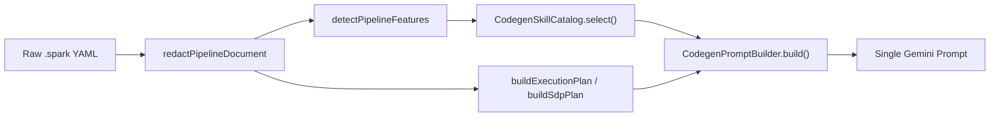

# Codegen Skills Authoring Guide

> **Author**: Mike Nimer <mikenimer@google.com>

The `resources/codegen-skills/` directory stores the modular prompt library for Apache Spark 4.x code generation. Imperative PySpark (`paradigm: imperative`), Spark Declarative Pipelines (`paradigm: sdp`), and Jupyter Notebook (`paradigm: notebook`) all assemble prompts from these skills. Code modules never hardcode prompt prose. Instead, TypeScript modules validate, select, and order these skills into one deterministic model call.

---

## 1. Single-Call Prompt Architecture & Section Order

Code generation executes in a single Gemini model call (`gemini-4-hydrogen` default via `src/codegen/modelDiscovery.ts` on Vertex AI `location: 'global'`). Both the VS Code extension (`src/codeGeneration.ts`) and the integration runner (`src/test/integration/codegen-runner.ts`) call `buildPromptFromPipelineYaml` (`src/codegen/CodegenPromptBuilder.ts`). Sharing one entry point guarantees identical prompt assembly between interactive sessions and automated tests.



When a user or test triggers generation, `buildPromptFromPipelineYaml` runs five deterministic stages:

1. Redact sensitive properties in the `.spark` YAML with `redactPipelineDocument` before prompt construction.
2. Extract language, paradigm, runners, `spark_transform` IDs, and graph features with `detectPipelineFeatures` (`src/codegen/PipelineFeatureDetector.ts`).
3. Compute the `ExecutionPlan` (`src/shared/executionPlanner.ts`) and, for `sdp` pipelines, the `SdpExecutionPlan` (`src/shared/sdpPlanner.ts`).
4. Filter and sort matching skills with `CodegenSkillCatalog.select()` (`src/codegen/CodegenSkillCatalog.ts`).
5. Resolve `{{spark_version}}` inside skill text and join the five ordered prompt sections in `CodegenPromptBuilder.build()`.

`CodegenPromptBuilder.build()` emits sections in this exact order:

| Order | Prompt Section | Emitted Content |
| :--- | :--- | :--- |
| `1` | `codegen-common` | Role, JSON output contract, and global deliverable rules (`SKILL.md` plus optional `### Python specifics`), without a `## Skill:` heading. |
| `2` | `## Pipeline YAML` | Redacted `.spark` YAML wrapped in a fenced `yaml` block verbatim without placeholder substitution. |
| `3` | `## Execution Plan` or `## SDP Execution Plan` | Deterministic Markdown summary bullets followed by the serialized plan in a fenced `json` block (`imperative` vs `sdp`). |
| `4` | Credential redaction notice | Emitted only when `redactPipelineDocument` replaced at least one credential path. |
| `5` | `## Skill: <name>` | Every remaining selected skill sorted by `SKILL_KIND_ORDER`, appending `### Python specifics` (`python.md`) and `#### Template: <file>` blocks. |

`SKILL_KIND_ORDER` (`src/codegen/codegenConfig.ts`) defines the strict prompt sequence for section `5`:

1. `common` (`codegen-common`, already placed at the head of the prompt)
2. `language` (`core-pyspark`, `sdp-core`)
3. `runner` (`runner-dataproc-cluster`, `runner-local`, `runner-sdp`, `runner-serverless-spark`)
4. `io` (`io-<connector>` source and sink skills)
5. `transform` (`transform-<step>` transformation skills)
6. `crosscutting` (`core-catalyst-optimization`, `core-python-datasource`, `core-streaming`, `sdp-auto-cdc`, `sdp-quality-quarantine`, `sdp-spec`)
7. `review` (reviewer-only rubric skills when present)
8. `gate` (`verification-gate`, always placed last as the pre-output checklist)

---

## 2. Skill Folder Layout & Byte-Identical Runner Templates

`CodegenSkillCatalog.load()` scans subdirectories under `resources/codegen-skills/` and ignores root documentation files such as `README.md`. Every skill subdirectory follows a strict file layout:

```text
resources/codegen-skills/
├── README.md
├── <skill-name>/
│   ├── SKILL.md
│   └── python.md                       # Optional language reference
└── runner-<runner-id>/
    ├── SKILL.md
    └── templates/
        └── python/
            └── <template-file>         # Runner script, Dockerfile, or YAML manifest
```

- **`<name>/SKILL.md` (required)**: Contains the `---` YAML frontmatter block followed by Markdown generation rules. The frontmatter `name` value must match `<name>` exactly.
- **`<name>/python.md` (optional)**: Holds Python-specific SDK reference material. When present, `renderSkill` appends it under `### Python specifics`. If a skill includes any `<language>.md` file, it must provide one for every language listed in `metadata.languages`.
- **`runner-<id>/templates/python/<file>` (runner skills)**: Holds executable shell wrappers, container definitions, or stage manifests inlined under `#### Template: <file>`.
- **Fail-fast attachment check**: `readAttachments` (`src/codegen/CodegenSkillCatalog.ts`) throws an error if a skill folder or `templates/` directory contains any unrecognized file or subfolder.

### Byte-Identical Runner Template Rule

Every file under `resources/codegen-skills/runner-*/templates/python/` must remain byte-identical to its mirror in `resources/templates/pyspark/`:

| Runner Skill | Bundled Skill Template Path | Mirror Path in `resources/templates/pyspark/` |
| :--- | :--- | :--- |
| `runner-local` | `runner-local/templates/python/run_local.sh` | `resources/templates/pyspark/run_local.sh` |
| `runner-dataproc-cluster` | `runner-dataproc-cluster/templates/python/run_dataproc_cluster.sh` | `resources/templates/pyspark/run_dataproc_cluster.sh` |
| `runner-serverless-spark` | `runner-serverless-spark/templates/python/Dockerfile` | `resources/templates/pyspark/Dockerfile` |
| `runner-serverless-spark` | `runner-serverless-spark/templates/python/run_serverless_spark.sh` | `resources/templates/pyspark/run_serverless_spark.sh` |
| `runner-sdp` | `runner-sdp/templates/python/run_sdp_local.sh` | `resources/templates/pyspark/run_sdp_local.sh` |
| `runner-sdp` | `runner-sdp/templates/python/run_sdp_dataproc.sh` | `resources/templates/pyspark/run_sdp_dataproc.sh` |
| `runner-sdp` | `runner-sdp/templates/python/sdp_stage.pipeline.yaml` | `resources/templates/pyspark/sdp_stage.pipeline.yaml` |

If a template drifts from its `resources/templates/pyspark/` mirror, `src/test/unit/codegen/codegen-skills-invariants.test.ts` fails immediately.

---

## 3. Strict Frontmatter Schema (`src/codegen/skillFile.ts`)

`parseSkillFile` (`src/codegen/skillFile.ts`) parses the opening `---` block with a strict zero-dependency parser, and `buildSkill` (`src/codegen/CodegenSkillCatalog.ts`) validates every field against allow-lists. Unknown top-level keys, unknown `metadata` keys, malformed lists, or unknown enum values throw immediately at load time.

```yaml
---
name: io-iceberg
description: Read and write batch or streaming Apache Iceberg tables in PySpark 4.x across BigLake REST, REST, Hive, Hadoop, AWS Glue, Project Nessie, and BigQuery Metastore catalogs.
metadata:
  kind: io
  usedBy: [generator, reviewer]
  languages: [python]
  runners: [all]
  paradigms: [imperative, sdp]
  transforms: [IcebergSource, IcebergSink]
  preloadWhen: []
  sources:
    - prompt
    - https://iceberg.apache.org/docs/latest/spark-queries/
  validated: true
---
```

### Top-Level Keys (`SKILL_TOP_LEVEL_KEYS`)

| Key | Type | Requirement |
| :--- | :--- | :--- |
| `name` | Scalar string | Required. Must equal the parent skill folder name. |
| `description` | Scalar string | Required. One concise active-voice sentence with zero semicolons. |
| `metadata` | Nested map | Required. Holds only keys from `SKILL_METADATA_KEYS`. |

### Metadata Keys (`SKILL_METADATA_KEYS`)

Lists inside `metadata` support flow syntax (`[a, b]`) or indented block items (`- a`).

| Metadata Key | Type | Allowed Values / Contract |
| :--- | :--- | :--- |
| `kind` | Required string | One of `common`, `language`, `runner`, `io`, `transform`, `crosscutting`, `review`, `gate` (`SKILL_KIND_ORDER`). |
| `usedBy` | Required list | Non-empty subset of `generator`, `reviewer` (`SKILL_CALLERS`). |
| `languages` | Required list | Non-empty list containing `all` or `python` (`ALL_SKILL_LANGUAGES`). |
| `runners` | Required list | Non-empty list containing `all` or values from `local`, `dataproc-cluster`, `serverless-spark`, `sdp`, `notebook` (`SKILL_RUNNERS`). |
| `paradigms` | Required list | Non-empty list containing `all`, `imperative`, `sdp`, or `notebook` (`SKILL_PARADIGMS`). Bundled skills must declare `paradigms` explicitly. |
| `transforms` | Optional list | Exact catalog `sparkTransform` IDs (defaults to `[]`). Checked against the palette catalog and `SPARK_NODE_CAPABILITIES`. |
| `preloadWhen` | Optional list | Subset of `PIPELINE_FEATURES`: `side_inputs`, `multi_output`, `streaming`, `custom_instructions`, `python_datasource`, `xlang`, `sdp_auto_cdc`, `sdp_quarantine`. |
| `sources` | Optional list | Provenance markers (`prompt` and `https://` official documentation URLs). Every non-legacy skill requires at least one `https://` URL. |
| `validated` | Optional boolean | `true` or `false` (defaults to `false`). Set to `true` after generated code compiles and passes tests. |

`sources` and `validated` exist for human maintainers and invariant tests only. `CodegenPromptBuilder` never emits frontmatter, `sources`, or `validated` into built prompts.

---

## 4. Selection Rules & 1-to-1 Catalog Ownership

### Skill Selection (`CodegenSkillCatalog.select()`)

`CodegenSkillCatalog.select()` includes a skill when all five conditions hold:

1. `usedBy` contains the active `caller` (`generator` or `reviewer`).
2. `paradigms` contains `all` or matches the detected paradigm (`imperative` by default, `sdp`, or `notebook`).
3. `languages` contains `all` or matches the target skill language (`python`).
4. `runners` contains `all` or intersects the active paradigm runner set.
5. The skill satisfies at least one activation rule:
   - `kind` belongs to `ALWAYS_ON_KINDS` (`common`, `language`, `runner`, `review`, `gate`).
   - `kind` is `crosscutting` with empty `transforms` and empty `preloadWhen` (such as `core-catalyst-optimization` or `sdp-spec`).
   - `transforms` intersects the resolved `spark_transform` set in the graph.
   - `preloadWhen` intersects the detected `PIPELINE_FEATURES` set.

Selected skills sort by `SKILL_KIND_ORDER` first and alphabetically by `name` second (`compareSkills`).

### Runner Parity Rule (`LANGUAGE_RUNNERS` vs `SDP_LANGUAGE_RUNNERS`)

The active runner selected in the Deployment tab does not filter generated runner scripts:

- **Imperative mode (`LANGUAGE_RUNNERS.python`)**: Requests `local`, `dataproc-cluster`, and `serverless-spark` together so every generated repository includes `run_local.sh`, `run_dataproc_cluster.sh`, `run_serverless_spark.sh`, and `Dockerfile`.
- **SDP mode (`SDP_LANGUAGE_RUNNERS.python`)**: Requests `sdp` only (`runner-sdp`), inlining `sdp_stage.pipeline.yaml`, `run_sdp_local.sh`, and `run_sdp_dataproc.sh`.
- **Notebook mode (`NOTEBOOK_LANGUAGE_RUNNERS.python`)**: Requests `notebook` only (`runner-notebook`), inlining `run_notebook.sh`.

### Feature Detection Triggers (`PipelineFeatureDetector.ts`)

| `PIPELINE_FEATURES` Flag | When `detectPipelineFeatures` Sets the Flag |
| :--- | :--- |
| `side_inputs` | Any edge sets `targetHandle: 'side_input'`. |
| `multi_output` | Any edge sets `sourceHandle: 'valid'` or `sourceHandle: 'error'`. |
| `streaming` | `computeStreamingNodeSet` finds streaming nodes, a node sets `readMode: 'streaming'`, or a node matches `STREAMING_SOURCE_TRANSFORMS` or `STREAMING_STEP_TRANSFORMS`. Explicit `readMode: 'batch'` suppresses default source streaming. |
| `custom_instructions` | Any node populates `data.system_instructions`, `properties.codeGenerationPrompt`, or `properties.prompt`. |
| `python_datasource` | Any node matches `PYTHON_DATASOURCE_TRANSFORMS` or resolves to `mechanism: 'python_datasource'` in `src/spark/versionMatrix.ts` (preloads `core-python-datasource`). |
| `xlang` | Any node matches `XLANG_TRANSFORMS[language]`. |
| `sdp_auto_cdc` | `paradigm` is `sdp` and the graph contains `MergeCdcScd` (preloads `sdp-auto-cdc`). |
| `sdp_quarantine` | `paradigm` is `sdp` and the graph contains `DataQualityAssert` or a DLQ-routed `EnforceSchemaAndCast` / `ParsePayload` step (preloads `sdp-quality-quarantine`). |

### 1-to-1 Catalog Ownership

Every palette node in `webview/src/catalog/nodes/` (`111` total) resolves to exactly one owning skill in `TRANSFORM_OWNER_KINDS` (`io` or `transform`):

- **Sources (`40` `SOURCE_NODES` in `sources.ts`) & Sinks (`38` `SINK_NODES` in `sinks.ts`)**: Owned by `kind: io` skills named `io-<connector>`. When a connector supports both reading and writing, one `io-<connector>` skill owns both `<Name>Source` and `<Name>Sink` (`transforms: [IcebergSource, IcebergSink]`). Create separate `io-*` folders only for source-only (`io-create-dataframe`, `io-rate`, `io-rest-api`, `io-sftp`, `io-socket`) or sink-only (`io-console`, `io-foreach-batch`, `io-memory`, `io-vector-store`) connectors.
- **Steps (`33` `STEP_NODES` in `steps.ts`)**: Owned by `33` `kind: transform` skills named `transform-<slug>`.
- **Zero Duplicate Owners**: No two `io` or `transform` skills may list the same `sparkTransform`. Only `kind: crosscutting` skills (`core-streaming`, `core-python-datasource`, `sdp-auto-cdc`, `sdp-quality-quarantine`) may co-list catalog transforms as preload triggers.
- **Transform Alias Resolution**: `CodegenSkillCatalog.resolveTransform()` checks exact catalog names first, then normalized keys from `transformKey()` without trailing `IO`, `Source`, or `Sink`. Next, it strips `TRANSFORM_ALIAS_PREFIXES` (`readfrom`, `writeto`, `read`, `write`). If both `<Name>Source` and `<Name>Sink` exist, bare `<Name>` matches two transforms and `resolveTransform()` refuses to guess.

---

## 5. Placeholders & Deterministic `ExecutionPlan` / `SdpExecutionPlan` Contract

### Allowed `{{...}}` Placeholders

`codegen-skills-invariants.test.ts` scans every file under `resources/codegen-skills/` and rejects any double-brace token outside these two groups:

- **Builder-Resolved Placeholder (`SPARK_VERSION_PLACEHOLDER`)**:
  - `{{spark_version}}` — `resolveSparkVersion` (`src/codegen/CodegenPromptBuilder.ts`) replaces this token inside rendered skill text before `## Pipeline YAML` joins the prompt. `CodegenPromptBuilder` never substitutes placeholders inside user `.spark` YAML, so literal `{{spark_version}}` or `$` values in properties stay intact.
- **Model-Facing Placeholders (`MODEL_FACING_PLACEHOLDERS`)**:
  - `{{pipeline_name}}` — Preserved verbatim in the prompt so Gemini substitutes the pipeline slug in generated filenames, application names, and paths.
  - `{{pipeline_class_name}}` — Preserved verbatim in the prompt so Gemini substitutes the PascalCase pipeline identifier where required.
  - `{{gcs_staging_path}}` — Preserved verbatim in the prompt so Gemini substitutes the Google Cloud Storage staging URI in runner scripts and manifests.

Never invent custom `{{...}}` placeholders in `SKILL.md`, `python.md`, or runner templates. Inside shell runner templates, use standard POSIX environment variables such as `${PROJECT_ID}`, `${REGION}`, and `${DEPS_BUCKET}`. `ReadOnlyCheckRunner` (`leftover_tokens`) fails review checks if any `{{...}}` token or credential redaction sentinel remains in generated files.

### Imperative `## Execution Plan` Contract (`ExecutionPlan`)

In `imperative` mode, `renderExecutionPlan` (`src/codegen/CodegenPromptBuilder.ts`) injects a Markdown summary and serialized JSON object computed by `buildExecutionPlan` (`src/shared/executionPlanner.ts`). Skills reference these exact JSON fields instead of asking the model to infer graph topology:

| Serialized JSON Key | Type / Source | How Skills Reference the Directive |
| :--- | :--- | :--- |
| `sortedNodeIds` | `string[]` | Ordered topological node IDs with terminal `SINK` nodes last. Skills evaluate `read_sources`, `transform`, and `write_sinks` in this exact sequence. |
| `pipelineMode` & `isStreaming` | `'batch' \| 'streaming'` & `boolean` | Selects batch execution vs Structured Streaming (`spark.streams.awaitAnyTermination()`). |
| `nodes` | `Record<string, NodeExecutionPlan>` | Per-node `executionMode`, `joinMode`, `isCached`, `isForeachBatchSink`, `conditionalBranches`, and `streamingSinkSettings`. |
| `streamingNodeIds` | `string[]` | Ordered IDs of all nodes executing on streaming DataFrames. |
| `cacheDirectives` (`cacheNodes`), `cachedNodeIds`, `unpersistPoints` | `CacheDirective[]`, `string[]`, `Record<string, string[]>` | Marks batch fan-out and DLQ DataFrames for `.cache()` before branching. Calls `.unpersist()` after downstream sink writes finish. |
| `streamingSinkGroups` & `foreachBatchSinkIds` | `StreamingSinkGroup[]` & `string[]` | Groups streaming sinks into `mode: 'native'` writers or shared `mode: 'foreachBatch'` writers. Carries `requiresBatchCache`, `idempotentTxnOptions`, and `txnAppId`. |
| `dlqSplitPoints` (`dlqRoutes`) | `DlqSplitPoint[]` | Specifies error-routing splits (`_corrupt_record`, `negated_predicate`, `expectation_violation`, or `try_except_error_col`) plus `validTargetIds` and `errorTargetIds`. |
| `conditionalSplits` | `ConditionalSplitPlan[]` | Ordered rule branches (`handleId`, `condition`, `targetNodeIds`) followed by the fallback `else` branch (`isFallback: true`). |
| `runtimeArtifacts`, `runtimeJars`, `runtimePackages`, `sparkProperties` | `PipelineRuntimeArtifacts` & shortcuts | Resolved `profile`, `tier`, `gcsJars`, `mavenPackages`, `pipPackages`, `sparkProperties`, `pythonDataSources`, and `preinstalledConnectors` wired into `requirements.txt` and `run_*.sh`. |

### Declarative `## SDP Execution Plan` Contract (`SdpExecutionPlan`)

In `sdp` mode, `renderSdpExecutionPlan` (`src/codegen/CodegenPromptBuilder.ts`) injects a Markdown summary and serialized JSON object computed by `buildSdpPlan` (`src/shared/sdpPlanner.ts`):

| Serialized JSON Key | Type / Source | How SDP Skills Reference the Directive |
| :--- | :--- | :--- |
| `isCompatible`, `blockingIssues`, `warnings` | Gate status & diagnostics | Reports compatibility status, blocking error codes, and operational refresh warnings. |
| `sortedNodeIds` | `string[]` | Topologically ordered node IDs across the declarative graph. |
| `datasets` & `datasetsByNodeId` | `SdpPlannedDataset[]` & map | Maps each node to `datasetName`, `kind` (`temporary_view`, `materialized_view`, `streaming_table`, `append_flow`, `auto_cdc`, `sink`), `badge`, `isStreaming`, `format`, and `upstreamDatasets`. Also sets `targetDataset` for `dp.create_auto_cdc_flow`, `quarantineDatasetName` for `_quarantine` tables, `resetAllowed`, `partitionCols`, and `clusterBy`. |
| `hasExternalSinks`, `externalSinkNames`, `materializedViewNames`, `streamingTableNames` | `boolean` & `string[]` | Identifies external `dp.create_sink` targets, truncated materialized views, and persisted streaming tables for `README.md` refresh documentation. |
| `usesIceberg` & `specConfig` | `boolean` & object | Provides `storage`, `catalog`, `database`, `bigLakeMode`, and string-only `dynamicConfiguration` for root `spark-pipeline.yml` (`sdp-spec`). |
| `staticRunnerProperties` | `Record<string, string>` | Routes static keys (`spark.sql.extensions`, `spark.jars*`, `spark.driver.*`, `spark.executor.*`, `spark.dynamicAllocation.*`, `dataproc.*`) to `sdp_stage.pipeline.yaml` and CLI `--conf`. Prevents `CANNOT_MODIFY_STATIC_CONFIG` inside `spark-pipeline.yml`. |
| `runtimeArtifacts` & `pipPackages` | `PipelineRuntimeArtifacts` & `string[]` | Resolves `pyspark[connect]==4.2.*`, `pyyaml>=6.0`, `zstandard>=0.25.0`, `pytest>=8.0.0`, connector packages, `gcsJars`, and `preinstalledConnectors` (`runner-sdp`). |

---

## 6. Authoring Workflow, Synchronization & Optional Reviewer

### Skill Authoring Checklist

Follow these steps when adding or updating a codegen skill:

1. Extend an existing `io-<connector>` skill for paired Sources and Sinks instead of creating a duplicate folder.
2. Declare all required frontmatter fields in `SKILL.md` with explicit `paradigms` and an `https://` URL in `metadata.sources`.
3. Write imperative examples around `read_sources(spark, config)`, pure `transform(dfs, config)`, `write_sinks(dfs, config)`, and offline `tests/test_pipeline.py` fixtures.
4. Synchronize `STREAMING_SOURCE_TRANSFORMS`, `STREAMING_STEP_TRANSFORMS`, and `PYTHON_DATASOURCE_TRANSFORMS` in `src/codegen/codegenConfig.ts` with `src/shared/sparkNodeCapabilities.ts` and `src/spark/versionMatrix.ts`.
5. Copy any runner template change between `resources/codegen-skills/runner-*/templates/python/` and `resources/templates/pyspark/`.
6. Run the skill invariant and catalog test suites to verify schema, placeholder, and ownership parity.

### Pinned Credential Rules & Classpath Hygiene

- **Preserve `## Credential Handling Rules` in `core-pyspark/SKILL.md`**: `src/test/unit/credential-redaction.test.ts` pins the `## Credential Handling Rules` heading and `*Secret` property rules (`passwordSecret`, `accessKeySecret`, `secretName`). Resolve secrets once at initialization via `access_secret_version(...)`, and read redacted credentials from environment variables.
- **Managed Spark Classpath Rules**: On Dataproc Cluster or Serverless Spark, never pass pre-installed connectors (`spark-bigquery`, `iceberg-spark-runtime`, `gcs-connector`, `hadoop-aws`, `hadoop-azure`) to `--packages` or `spark.jars.packages`. Pass Maven `--packages` coordinates in `run_local.sh` only.
- **Python DataSource Laziness**: For `core-python-datasource` connectors, instantiate clients lazily inside executor callbacks (`DataSourceReader.read`, `foreachPartition`, `mapInPandas`). Never instantiate clients in driver `__init__` or per row.

### Optional Post-Generation Reviewer Pass

The optional reviewer pass (`src/codegen/reviewerPass.ts` and `src/codegen/CodeReviewer.ts`) is off by default (`CODEGEN_REVIEWER_ENABLED_BY_DEFAULT = false`). Users enable it with VS Code setting `sparkDesigner.codegen.enableReviewer`.

When enabled, `runReviewerPass` executes a bounded verification loop after initial generation:

1. Run deterministic `ReadOnlyCheckRunner` checks (`required_files`, `leftover_tokens`, `python_syntax`, `sdp_spec_contract`, `pipeline_contract`, `test_imports`, `pytest_collect`, `sdp_dry_run`).
2. Assemble the reviewer context by calling `buildPromptFromPipelineYaml` with `caller: 'reviewer'`.
3. Combine `resources/codegen-prompts/reviewer.md`, reviewer skills, generated files, and check results into one review call.
4. If `blocking` findings exist, invoke `resources/codegen-prompts/fix.md` for at most `2` repair rounds (`CODEGEN_REVIEWER_MAX_FIX_ROUNDS`).

Each review finding cites the broken skill name in `skillRule`. Clear, testable rules in `SKILL.md` directly improve generation accuracy and automated repair.

### Verification Commands

Run these commands from the repository root after editing any skill or documentation file:

```bash
npx vitest run src/test/unit/codegen/codegen-skills-invariants.test.ts src/test/unit/codegen/CodegenSkillCatalog.test.ts
npm run typecheck
```
